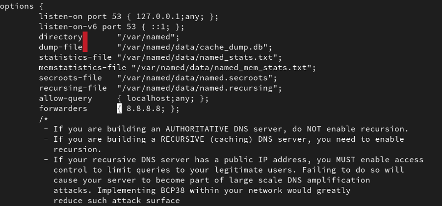
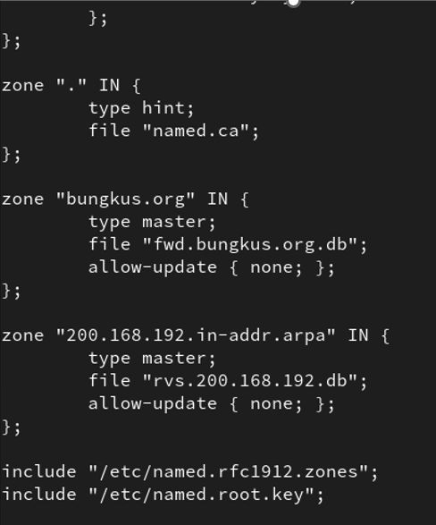
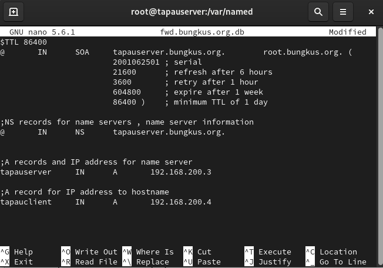
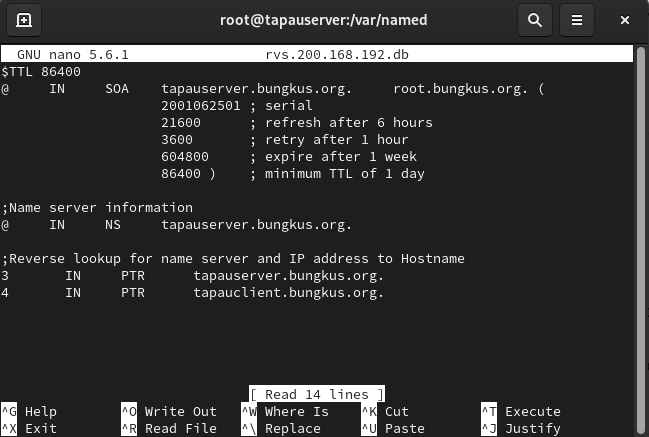
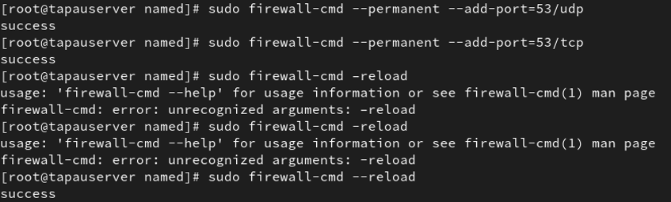

# 01 DNS server (BIND)

## Purpose

This runbook sets up an authoritative and caching DNS server with BIND on Rocky Linux 9.7. It serves one forward zone (`bungkus.org`) and one reverse zone (`200.168.192.in-addr.arpa`) for a small VirtualBox lab network, and forwards everything else to 8.8.8.8. An Ubuntu 24.04 client is then pointed at it and tested with `nslookup`, `ping` and `dig`.

## Environment

| Item | Value |
|---|---|
| Server | Rocky Linux 9.7, hostname `tapauserver.bungkus.org`, interface `enp0s3` |
| Client | Ubuntu 24.04, hostname `tapauclient.bungkus.org` |
| Network | 192.168.200.0/24, gateway 192.168.200.1 (VirtualBox NAT network) |
| Server IP in the zone files and NetworkManager profile | 192.168.200.3 |
| Client IP in the zone files | 192.168.200.4 |
| Packages | `bind`, `bind-utils` |
| Domain | `bungkus.org` (fictional) |

See the note under Verification about the IP addresses shown in some test output.

## Steps

1. Install BIND. `bind-utils` provides `dig`, `nslookup`, `named-checkconf` and `named-checkzone`.
   ```bash
   sudo dnf install -y bind bind-utils
   ```
2. Enable and start `named` so it survives reboots.
   ```bash
   sudo systemctl enable named --now
   sudo systemctl status named
   ```
3. Back up the stock config before editing it.
   ```bash
   sudo cp -p /etc/named.conf /etc/named.conf.bak
   ```
4. Edit the `options` block: listen on all addresses, allow queries from anywhere, set the forwarder (see Configuration).
   ```bash
   su -
   nano /etc/named.conf
   ```
5. Add the two zone declarations below the `zone "."` block, then check syntax. No output means the file parses.
   ```bash
   named-checkconf
   ```
6. Create the zone files in `/var/named`.
   ```bash
   cd /var/named
   nano fwd.bungkus.org.db
   nano rvs.200.168.192.db
   ls -l
   ```
7. Validate the zones. The report ran `named-checkzone` against the reverse file and got "loaded serial 2001062501". The zone-name argument it used was the file name rather than the zone name; the form below is the correct one.
   ```bash
   named-checkzone bungkus.org fwd.bungkus.org.db
   named-checkzone 200.168.192.in-addr.arpa rvs.200.168.192.db
   ```
8. Open port 53 for UDP and TCP and reload. TCP is needed for large answers and zone transfers. The first reload attempt in the report failed because of a single-dash `-reload`; the option is `--reload`.
   ```bash
   sudo firewall-cmd --permanent --add-port=53/udp
   sudo firewall-cmd --permanent --add-port=53/tcp
   sudo firewall-cmd --reload
   ```
9. Make the server use itself for DNS. Edit the NetworkManager profile (static address, own IP as DNS, `ignore-auto-dns=true`), then restart NetworkManager and `named`.
   ```bash
   nano /etc/NetworkManager/system-connections/enp0s3.nmconnection
   systemctl restart NetworkManager
   sudo systemctl restart named
   cat /etc/resolv.conf
   ```
10. Point the Ubuntu client at the server. GUI: Settings, Wired, gear icon, IPv4 tab, turn off Automatic DNS and enter the server address. Command line: enable `systemd-resolved`.
    ```bash
    sudo systemctl enable systemd-resolved
    sudo systemctl start systemd-resolved
    sudo systemctl status systemd-resolved
    ```
11. Test from the client (see Verification).

## Configuration

- [named.conf](../configs/01-dns-bind/named.conf): options block (`listen-on port 53 { 127.0.0.1;any; }`, `allow-query { localhost;any; }`, `forwarders { 8.8.8.8; }`, `recursion yes`, `dnssec-validation no`) and the two zone declarations with `allow-update { none; }`. The file is partial: only the lines visible in the screenshots are reproduced.
- [fwd.bungkus.org.db](../configs/01-dns-bind/fwd.bungkus.org.db): SOA, one NS record, A records for `tapauserver` (192.168.200.3) and `tapauclient` (192.168.200.4).
- [rvs.200.168.192.db](../configs/01-dns-bind/rvs.200.168.192.db): PTR records `3` and `4` for the same two hosts.
- [enp0s3.nmconnection](../configs/01-dns-bind/enp0s3.nmconnection): static `192.168.200.3/24`, gateway 192.168.200.1, `dns=192.168.200.3;`, `ignore-auto-dns=true`. Partial file.


*The edited options block in `/etc/named.conf` with the 8.8.8.8 forwarder.*


*Forward and reverse zone declarations added under the root hint zone.*


*`fwd.bungkus.org.db` with the SOA, NS and two A records.*


*`rvs.200.168.192.db` with PTR records for hosts 3 and 4.*


*Port 53 added for UDP and TCP; the mistyped `-reload` is rejected and `--reload` succeeds.*

## Verification

What the report tested and saw:

- `systemctl status named` showed `active (running)` and `enabled`. The journal lines were "network unreachable" errors for IPv6 root servers, ending in "resolver priming query complete". The lab has no IPv6 route, so these are expected noise.
- `named-checkconf` printed nothing. `named-checkzone` reported "loaded serial 2001062501".
- From the client: `nslookup` and `dig` for `tapauserver.bungkus.org` and `tapauclient.bungkus.org` returned `NOERROR` with one answer each. The `tapauserver` answer carried the `aa` flag. `ping -c 4` to both names had 0% packet loss.
- An external check was shown as a browser page of Google results (Figure 1.8.4), not as a `ping google.com` output, so it shows only that the client had internet access.

Note on addresses: the zone files and NetworkManager profile use 192.168.200.3 for the server and 192.168.200.4 for the client. Several of the verification screenshots show the server at 192.168.200.4 and the client at 192.168.200.129, and `resolv.conf` pointing at 192.168.200.4. Those outputs came from a different VM setup than the one the zone files describe. The answers observed (`.4` for the server, `.129` for the client) therefore do not match the zone data above. Treat the zone files as the intended configuration and re-run the tests on one consistent set of addresses before relying on them.

## Troubleshooting

**No internet on the server after pointing it at itself.**
- Cause: `dnssec-validation yes` was on, the server was its own only resolver, and the lab had no working trust chain, so BIND returned SERVFAIL for every external name. The report reached this after a long search.
- Fix: set `dnssec-validation no;` in `options`, then `sudo systemctl restart named`.
- Trade-off: with validation off the server trusts whatever 8.8.8.8 returns. The report accepts this for an isolated lab. Do not copy it to a real network.

**`firewall-cmd -reload` rejected.** Use `--reload` (two dashes).

## Security notes

- `listen-on { 127.0.0.1;any; }`, `allow-query { localhost;any; }` and `recursion yes` make this an open recursive resolver for anyone who can reach port 53. The stock comment in the file warns about DNS amplification. Restrict `allow-query` and `allow-recursion` to `192.168.200.0/24` on anything reachable from outside the lab.
- DNSSEC validation is disabled, as described above.
- The new zone files were created as `root:root` mode 644, unlike the stock files (`root:named` 640). The report shows no problem from this.
