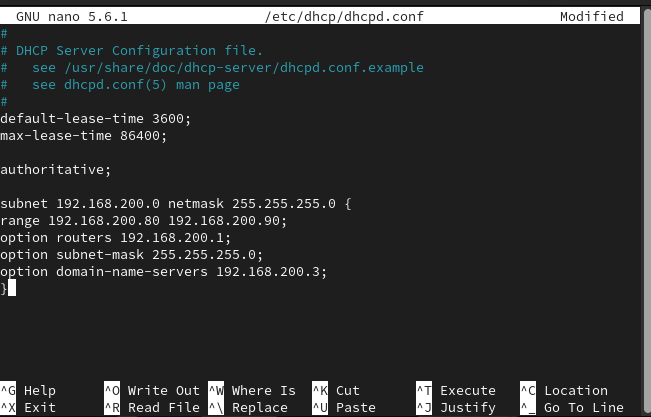
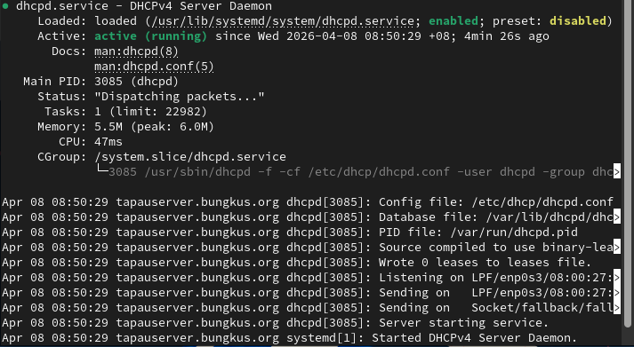
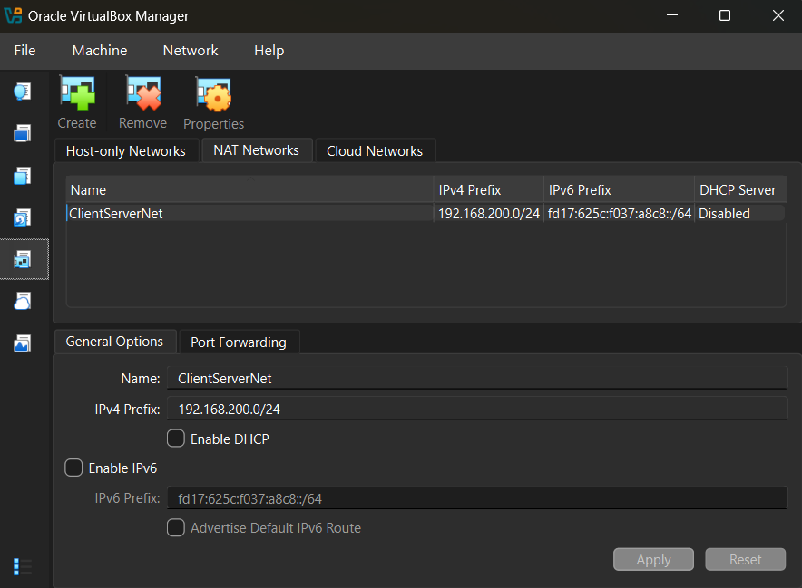
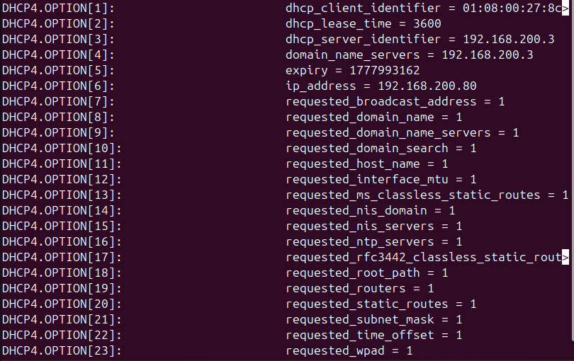

# 02 DHCP server (ISC dhcpd)

## Purpose

This runbook sets up an ISC DHCP server on the Rocky Linux server so the Ubuntu client receives its address, gateway and DNS server from it. VirtualBox's own DHCP service on the shared NAT network is switched off first, otherwise it would answer the client before the Rocky server does.

## Environment

| Item | Value |
|---|---|
| Server | Rocky Linux 9.7 (kernel 5.14), `tapauserver.bungkus.org`, `enp0s3`, 192.168.200.3 |
| Client | Ubuntu 24.04.4 LTS, `tapauclient.bungkus.org`, `enp0s3` |
| Hypervisor | VirtualBox, NAT network `ClientServerNet`, 192.168.200.0/24 |
| Package | `dhcp-server` (4.4.2, pulls in `dhcp-common`) |
| Pool | 192.168.200.80 to 192.168.200.90 |
| Gateway / DNS | 192.168.200.1 / 192.168.200.3 |

## Steps

1. Install the server.
   ```bash
   sudo dnf install -y dhcp-server
   ```
2. Write the configuration (see Configuration). Lease times, the pool, gateway, mask and DNS server are all set in the one `subnet` block.
   ```bash
   sudo nano /etc/dhcp/dhcpd.conf
   ```
3. Enable and start the service. `--now` starts it immediately and the unit is enabled for boot.
   ```bash
   sudo systemctl enable --now dhcpd.service
   sudo systemctl start dhcpd
   sudo systemctl status dhcpd
   ```
4. Allow DHCP through firewalld and check the rule list.
   ```bash
   sudo firewall-cmd --permanent --add-service=dhcp
   sudo firewall-cmd --reload
   sudo firewall-cmd --list-all
   ```
5. Shut down both VMs (Power off the machine). Settings must not change while they run.
6. In VirtualBox open File, Tools, Network, select the NAT network `ClientServerNet`, and untick Enable DHCP. The DHCP Server column should read Disabled.
7. Check that both VMs have Adapter 1 attached to NAT Network `ClientServerNet` (Settings, Network). The report shows this for both.
8. Start the server, then the client, and test (see Verification).

## Configuration

- [dhcpd.conf](../configs/02-dhcp/dhcpd.conf): `default-lease-time 3600` (1 hour), `max-lease-time 86400` (24 hours), `authoritative`, and a `subnet 192.168.200.0 netmask 255.255.255.0` block with `range 192.168.200.80 192.168.200.90`, `option routers 192.168.200.1`, `option subnet-mask 255.255.255.0` and `option domain-name-servers 192.168.200.3`.


*The finished `/etc/dhcp/dhcpd.conf`; the DNS option points at 192.168.200.3.*


*`dhcpd.service` enabled and active (running), listening on `enp0s3`, "Wrote 0 leases".*


*`ClientServerNet` (192.168.200.0/24) with Enable DHCP unticked and the DHCP Server column showing Disabled.*

## Verification

- Server: `systemctl status dhcpd` showed `enabled` and `active (running)`; the log lines show it listening and sending on `enp0s3` and "Server starting service".
- Client, `nmcli`: `enp0s3` connected with `inet4 192.168.200.80/24`, default route via 192.168.200.1, DNS server 192.168.200.3. This is the first address in the pool.
- Client, `nmcli -f dhcp4 device show enp0s3`: `dhcp_server_identifier = 192.168.200.3`, `domain_name_servers = 192.168.200.3`, `ip_address = 192.168.200.80`, `dhcp_lease_time = 3600`. This confirms the lease came from the Rocky server and not from VirtualBox.

```bash
nmcli
nmcli -f dhcp4 device show enp0s3
```


*`nmcli -f dhcp4 device show enp0s3`: server identifier and DNS 192.168.200.3, address 192.168.200.80, lease time 3600.*

## Troubleshooting

The report has no troubleshooting section for DHCP. Two inconsistencies in it are worth knowing:

- The written settings breakdown gives `option domain-name-servers 192.168.200.4` in one code block and `192.168.200.3` in the explanation list. The config screenshot and the client's lease both show `192.168.200.3`, so that is what the config file here uses.
- The environment table lists the Ubuntu client at 192.168.200.4 (static) before DHCP is switched on. After the test it holds 192.168.200.80 from the pool.

If a client still gets an address outside 192.168.200.80 to 192.168.200.90, the likely cause is that VirtualBox's DHCP was not disabled for the network both VMs use. This follows from step 6 but was not observed as a fault in the report.

## Security notes

- The firewalld listing in the report shows many unrelated services open on the server (`ftp`, `http`, `https`, `mysql`, `nfs`, `mountd`, `rpc-bind` and extra ports). Only `dhcp` is needed for this service.
- The report types `--add-service-mysql` (single dash) in one screenshot; it printed `success` in the capture, which is surprising, and it added `mysql` to the zone. That is not part of DHCP and should not be copied.
- There is no restriction on which clients may lease; any host on the network segment can take an address from the pool.
