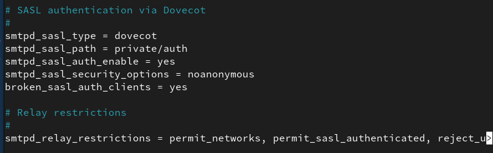
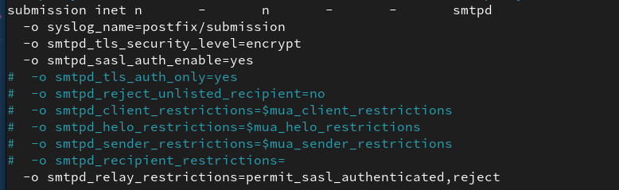
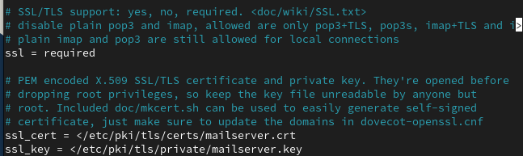
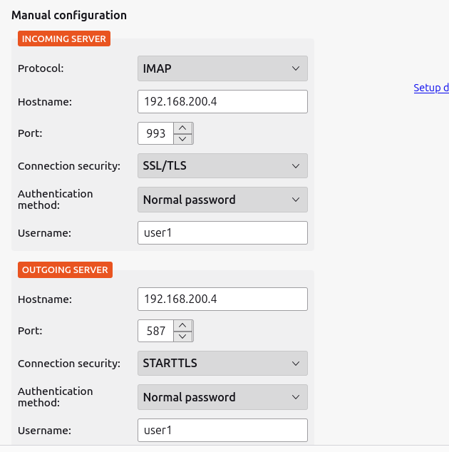
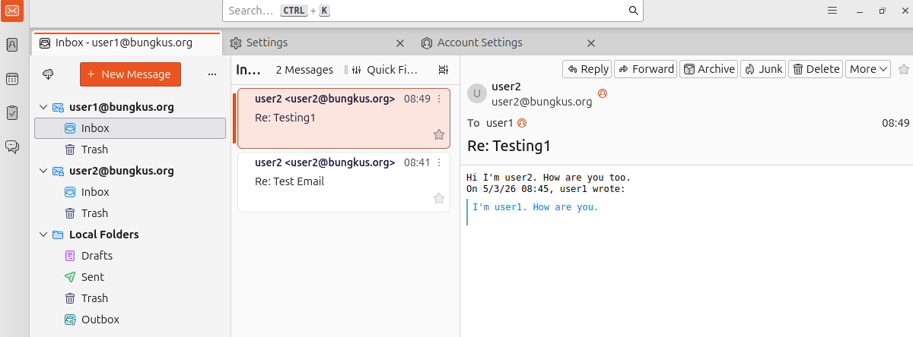
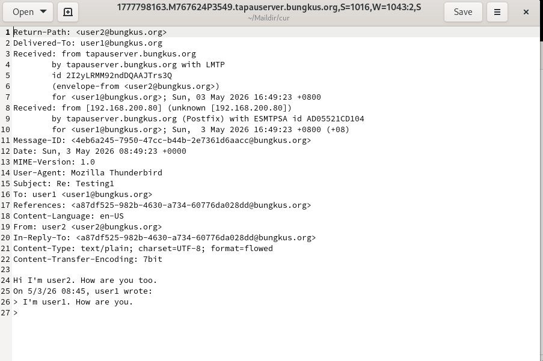

# 03 Email server (Postfix and Dovecot)

## Purpose

This runbook builds a small mail server on Rocky Linux 9.7 with Postfix (SMTP) and Dovecot (IMAP, POP3, LMTP). Mail for `bungkus.org` is stored in Maildir format in each user's home directory. Clients must use TLS, with a self-signed certificate from OpenSSL. Two local accounts, `user1` and `user2`, are used to send mail to each other from Thunderbird on the Ubuntu client.

## Environment

| Item | Value |
|---|---|
| Server | Rocky Linux 9.7, hostname `tapauserver.bungkus.org`, 192.168.200.4, interface `enp0s3` |
| Client | Ubuntu 24.04.4, hostname `tapauclient.bungkus.org`, 192.168.200.80 (DHCP) |
| Packages | `postfix`, `dovecot` (server); `thunderbird` (client) |
| Mail users | Local OS accounts `user1` and `user2`, addresses `user1@bungkus.org` and `user2@bungkus.org` |
| Ports | 25 (SMTP), 587 (submission, STARTTLS), 465 (SMTPS), 143/993 (IMAP/IMAPS), 110/995 (POP3/POP3S) |
| Domain | `bungkus.org` (fictional) |

The report's addresses in this section (server .4, client .80) differ from the zone files in the DNS runbook (server .3, client .4). Use whichever set matches your own VMs.

## Steps

1. Update the system, reboot, then install both packages. Updating first avoids dependency surprises.
   ```bash
   sudo dnf update -y
   reboot
   sudo dnf install postfix dovecot -y
   ```
2. Enable and start both services so they survive reboots, then check them.
   ```bash
   sudo systemctl enable postfix dovecot
   sudo systemctl start postfix dovecot
   sudo systemctl status postfix dovecot
   ```
3. Edit `/etc/postfix/main.cf`: identity, Maildir delivery through Dovecot LMTP, SASL through Dovecot, and relay restrictions (see Configuration). The relay line decides who may send mail through the server.
   ```bash
   sudo nano /etc/postfix/main.cf
   ```
4. Edit `/etc/postfix/master.cf` and uncomment the `submission` (587) and `smtps` (465) services. Submission forces TLS and SASL; smtps uses implicit TLS.
   ```bash
   sudo nano /etc/postfix/master.cf
   ```
5. Configure Dovecot in four files. Each setting is listed under Configuration. The `10-master.conf` sockets are what let Postfix talk to Dovecot for authentication and delivery.
   ```bash
   sudo nano /etc/dovecot/dovecot.conf
   sudo nano /etc/dovecot/conf.d/10-mail.conf
   sudo nano /etc/dovecot/conf.d/10-auth.conf
   sudo nano /etc/dovecot/conf.d/10-master.conf
   ```
6. Generate a self-signed certificate and key, then lock down the key. `-nodes` leaves the key without a passphrase so the services can start unattended.
   ```bash
   sudo openssl req -newkey rsa:2048 -nodes \
     -keyout /etc/pki/tls/private/mailserver.key \
     -x509 -days 1095 \
     -out /etc/pki/tls/certs/mailserver.crt
   sudo chmod 600 /etc/pki/tls/private/mailserver.key
   sudo chmod 644 /etc/pki/tls/certs/mailserver.crt
   openssl x509 -in /etc/pki/tls/certs/mailserver.crt -text -noout | grep -A2 "Subject:"
   ```
7. Add the TLS parameters to `main.cf` and edit `/etc/dovecot/conf.d/10-ssl.conf` (`ssl = required`, TLS 1.2 minimum). This turns the certificate on for both daemons.
   ```bash
   sudo nano /etc/dovecot/conf.d/10-ssl.conf
   sudo systemctl restart postfix dovecot
   sudo journalctl -u postfix --since "1 min ago" | tail -20
   ```
8. Open the mail ports and services in firewalld. `--permanent` keeps the rules after a reboot; the reload applies them now.
   ```bash
   sudo firewall-cmd --permanent --add-port=25/tcp
   sudo firewall-cmd --permanent --add-port=587/tcp
   sudo firewall-cmd --permanent --add-port=465/tcp
   sudo firewall-cmd --permanent --add-port=143/tcp
   sudo firewall-cmd --permanent --add-port=993/tcp
   sudo firewall-cmd --permanent --add-port=110/tcp
   sudo firewall-cmd --permanent --add-port=995/tcp
   sudo firewall-cmd --permanent --add-service={smtp,smtps,imap,imaps,pop3,pop3s}
   sudo firewall-cmd --reload
   sudo firewall-cmd --list-all
   ```
   The report ran the services and ports as separate commands. The `{...}` form above is shorthand for the same six `--add-service` calls.
9. Set the SELinux booleans the report used, then check that SELinux is not denying anything. No output from `ausearch` means no denials.
   ```bash
   sudo setsebool -P httpd_can_sendmail 1
   sudo setsebool -P allow_postfix_local_write_mail_spool 1
   sudo ausearch -m avc -ts recent | grep -E "postfix|dovecot"
   ```
10. Create the two mail users. Set passwords of your own (CHANGE_ME).
    ```bash
    sudo useradd user1
    sudo passwd user1
    sudo useradd user2
    sudo passwd user2
    id user1
    id user2
    ```
11. On the Ubuntu client, install Thunderbird and check UFW. The report disabled UFW on the client for testing.
    ```bash
    sudo apt update
    sudo apt install thunderbird -y
    sudo ufw status
    sudo ufw disable
    ```
12. In Thunderbird, add a security exception for the self-signed certificate (Settings, Privacy & Security, Certificates, Manage Certificates, Servers) for `192.168.200.4:993` and `192.168.200.4:587`. Then add each account manually: IMAP `192.168.200.4` port 993 SSL/TLS, SMTP `192.168.200.4` port 587 STARTTLS, authentication "Normal password", username `user1` (or `user2`, no domain).
13. Test (see Verification).

## Configuration

Every file below is partial: only the lines visible in the report's screenshots are reproduced.

- [postfix-main.cf](../configs/03-email-postfix-dovecot/postfix-main.cf): identity (`myhostname`, `mydomain`, `myorigin`), `inet_protocols = ipv4`, `mynetworks = 127.0.0.0/8, 192.168.200.0/24`, `home_mailbox = Maildir/`, `mailbox_transport = lmtp:unix:private/dovecot-lmtp`, the Dovecot SASL block, `smtpd_relay_restrictions`, and the TLS block with SSLv2, SSLv3, TLS 1.0 and TLS 1.1 disabled. The first token of the relay line is cut off in the screenshot; the file uses the report text (`permit_mynetworks`).
- [postfix-master.cf](../configs/03-email-postfix-dovecot/postfix-master.cf): the `submission` and `smtps` entries.
- [dovecot.conf](../configs/03-email-postfix-dovecot/dovecot.conf): `protocols = imap pop3 lmtp`, `listen = *`.
- [dovecot-10-mail.conf](../configs/03-email-postfix-dovecot/dovecot-10-mail.conf): `mail_location = maildir:~/Maildir`, matching Postfix's `home_mailbox`.
- [dovecot-10-auth.conf](../configs/03-email-postfix-dovecot/dovecot-10-auth.conf): `disable_plaintext_auth = yes`, `auth_mechanisms = plain login`, `auth_username_format = %n` (strips the domain, so `user1@bungkus.org` logs in as `user1`).
- [dovecot-10-master.conf](../configs/03-email-postfix-dovecot/dovecot-10-master.conf): the `private/auth` and `private/dovecot-lmtp` sockets owned by `postfix`.
- [dovecot-10-ssl.conf](../configs/03-email-postfix-dovecot/dovecot-10-ssl.conf): `ssl = required`, certificate and key paths, `ssl_min_protocol = TLSv1.2`, `ssl_prefer_server_ciphers = yes`.
- [openssl-selfsigned-cert.sh](../configs/03-email-postfix-dovecot/openssl-selfsigned-cert.sh): the certificate command and the subject fields entered. The key is not in this repo.


*The SASL block and `smtpd_relay_restrictions` added to `main.cf`; the relay line runs off the screen edge.*


*The `submission` service uncommented in `master.cf`, with `smtpd_tls_security_level=encrypt` and SASL on.*


*`ssl = required` with the certificate and key paths in `10-ssl.conf`.*


*Thunderbird manual configuration: IMAP 993 with SSL/TLS, SMTP 587 with STARTTLS, username `user1`.*

## Verification

- `systemctl status` showed both `postfix` and `dovecot` as `active (running)` and enabled.
- The certificate subject read `C=JP, ST=Hiroshima, L=Hiroshima, O=Bungkus, OU=IT, CN=tapauserver.bungkus.org`. It is valid from 21 Apr 2026 for three years. The issuer equals the subject, and `Basic Constraints: CA: TRUE` was shown.
- After the restart the journal showed no errors. `ausearch` for SELinux denials returned `<no matches>`.
- `ss -tlnp` showed Postfix on 25 and 587 and Dovecot on 143 and 993, all on `0.0.0.0`. The OCR of this screenshot is garbled, so the port numbers here follow the report's text and caption.
- A manual IMAP login on `localhost:143` with `telnet` succeeded and listed `INBOX` and `Trash`. Dovecot allowed this plaintext login only because the connection came from localhost.
- `openssl s_client -connect localhost:993` completed the handshake and showed Dovecot's greeting, with `verify error:num=18:self-signed certificate` as expected.
- From Thunderbird, `user1` sent "Testing1" to `user2`; `user2` received it and replied; `user1` received the reply.
- The mail log showed an IMAP login with TLS from 192.168.200.80, a TLS 1.3 connection on the submission service (`TLS_AES_128_GCM_SHA256`), and the Postfix LMTP hand-off to Dovecot, which logged "saved mail to INBOX".
- The reply was found as a file under `/home/user1/Maildir/cur/` on the server, with `Received: ... with LMTP` and `with ESMTPSA` headers.


*`user1`'s inbox with "Re: Testing1" from `user2`.*


*The same reply as a Maildir file on the server, with LMTP and ESMTPSA headers.*

## Troubleshooting

**Thunderbird Certificate Manager shows "No Information Available" for 192.168.200.4:587.**
- Report's cause: port 587 was not open in the firewall, and the Certificate Manager cannot fetch a certificate from a STARTTLS port.
- Fix: `sudo firewall-cmd --permanent --add-port=587/tcp` then `sudo firewall-cmd --reload`. `telnet 192.168.200.4 587` from the client then returned the `220 tapauserver.bungkus.org ESMTP Postfix` banner. Sending a message afterwards worked and the log showed STARTTLS; the report concludes no manual exception is needed for port 587.
- The report's own output printed `ALREADY_ENABLED: 587:tcp` for that command, so the port may already have been open when the error occurred. The report does not explain this. The STARTTLS explanation is the more likely reason the Get Certificate button failed.

## Notes

- `mynetworks` includes 192.168.200.0/24 and `smtpd_relay_restrictions` starts with `permit_mynetworks`. Any host on that subnet can relay mail with no login. Remove the subnet from `mynetworks` if clients should always authenticate.
- `smtpd_tls_security_level = may` on port 25 makes TLS optional there. Only the submission service forces it. Port 25 must stay opportunistic to receive mail from other servers.
- The certificate is self-signed, with `CA: TRUE`, and the key has no passphrase. Every client needs a manual exception. Use a real CA or a private CA distributed to clients for anything beyond a lab.
- The firewall opens plain POP3 (110) and IMAP (143) as well as the TLS ports. `ssl = required` makes Dovecot demand TLS on them, but POP3 is not used by any test, so closing 110 and 995 would cut exposure. The report opened each mail port both by port number and by service name; the duplicates are harmless, and firewalld printed `ALREADY_ENABLED` warnings.
- Port 465 (smtps) is configured and open but no test used it.
- The report's first relay line in the screenshot reads `permit_networks`, which is not a Postfix keyword. The report text and the config here use `permit_mynetworks`. Run `postfix check` to confirm the live file is valid.
- `user2` was given a password that `passwd` flagged "BAD PASSWORD: The password is shorter than 8 characters", and the command accepted it anyway. The report's screenshots also show passwords in clear text in Thunderbird and in the telnet session; they are not reproduced here. Use strong passwords of your own (CHANGE_ME).
- UFW was disabled on the Ubuntu client to remove it as a variable. The report notes UFW only filters incoming traffic, so it would not have blocked Thunderbird's outgoing connections; re-enable it.
- The `setsebool httpd_can_sendmail` setting concerns the web server, not Postfix or Dovecot. The report gives no reason for it, and `ausearch` showed no denials either way.
- The report shows no MX record. Mail is addressed by IP in the clients and the zone files in the DNS runbook have no MX entry, so mail between domains by name was not tested.
