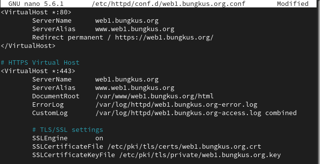
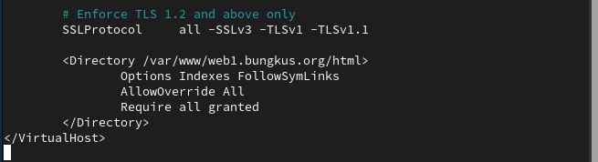
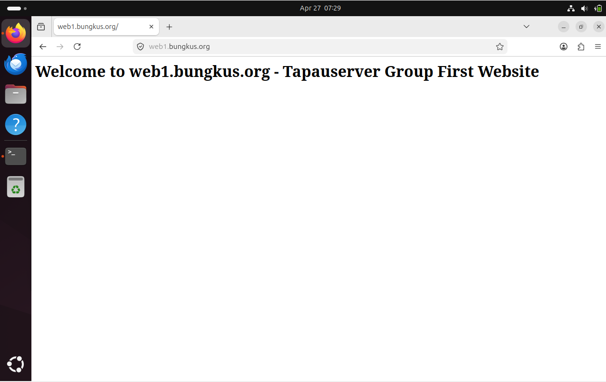
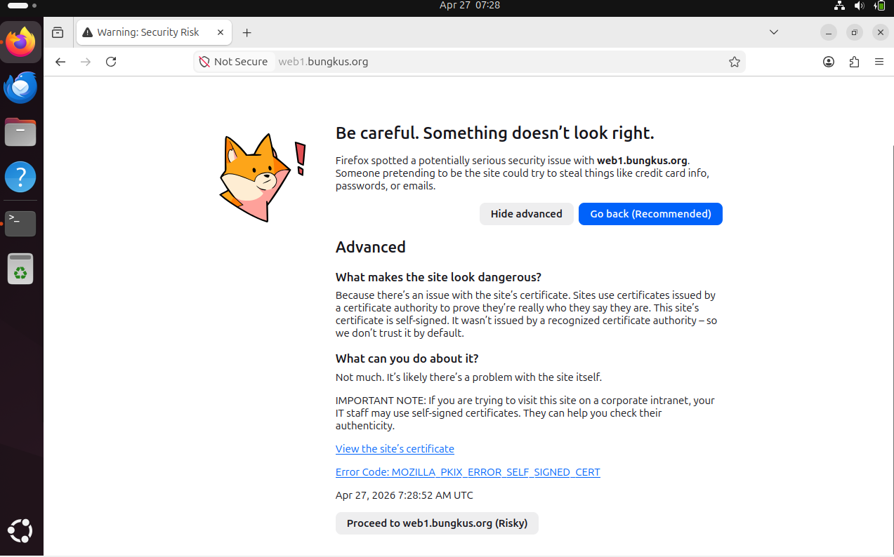
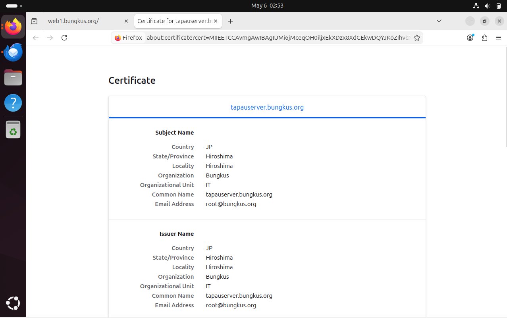
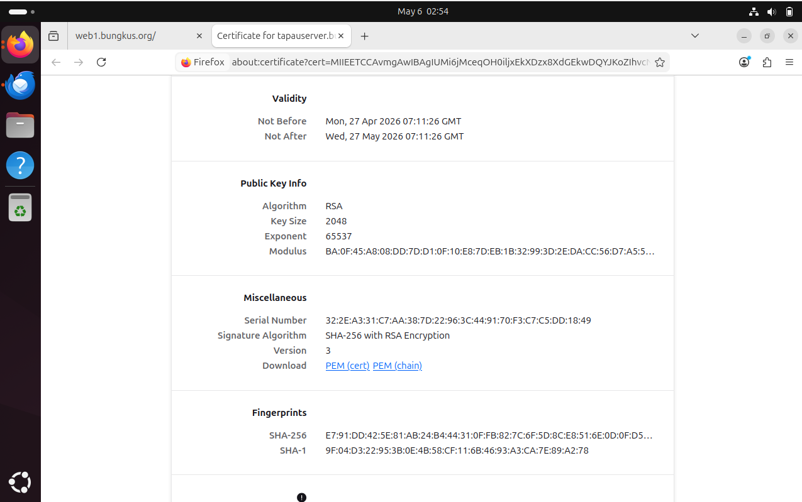

# 04 Web server (Apache with TLS)

## Purpose

This runbook sets up Apache (`httpd`) on Rocky Linux 9.7 to host two name-based virtual hosts, `web1.bungkus.org` and `web2.bungkus.org`. Each redirects HTTP to HTTPS and serves a one-line test page over TLS with a self-signed certificate. DNS records for both names are added to the BIND zone, and the sites are tested from the Ubuntu client with `curl` and Firefox.

## Environment

| Item | Value |
|---|---|
| Server | Rocky Linux 9.7, hostname `tapauserver.bungkus.org`, 192.168.200.4, interface `enp0s3` |
| Client | Ubuntu 24.04.4, hostname `tapauclient.bungkus.org`, 192.168.200.80 (DHCP) |
| Packages | `httpd`, `mod_ssl` (2.4.62 in the report); `curl` on the client |
| Sites | `web1.bungkus.org`, `web2.bungkus.org`, both resolving to 192.168.200.4 |
| Document roots | `/var/www/web1.bungkus.org/html`, `/var/www/web2.bungkus.org/html` |
| DNS | The BIND server from the DNS runbook |
| Domain | `bungkus.org` (fictional) |

## Steps

1. Install Apache, enable it at boot and start it now, then check it is running.
   ```bash
   sudo dnf install httpd -y
   sudo systemctl enable --now httpd
   sudo systemctl status httpd
   ```
2. Allow HTTP and HTTPS through firewalld. Without this the client cannot reach the server even though Apache is running.
   ```bash
   sudo firewall-cmd --permanent --add-service=http
   sudo firewall-cmd --permanent --add-service=https
   sudo firewall-cmd --reload
   sudo firewall-cmd --list-all
   ```
3. Create the document root, ownership, permissions and a test page for each site. Repeat with `web2` for the second site.
   ```bash
   sudo mkdir -p /var/www/web1.bungkus.org/html
   sudo chown -R $USER:$USER /var/www/web1.bungkus.org/html
   sudo chmod -R 755 /var/www/web1.bungkus.org/html
   echo "<h1>Welcome to web1.bungkus.org - Tapauserver Group First Website</h1>" | sudo tee /var/www/web1.bungkus.org/html/index.html
   ```
4. Install `mod_ssl` (it was already present in the report) and make sure the certificate directories exist.
   ```bash
   sudo dnf install mod_ssl -y
   sudo mkdir -p /etc/pki/tls/certs /etc/pki/tls/private
   ```
5. Generate one self-signed certificate per site. `-nodes` leaves the key without a passphrase so Apache can start unattended. At the prompts the report entered `tapauserver.bungkus.org` as the Common Name for both.
   ```bash
   sudo openssl req -x509 -nodes -newkey rsa:2048 \
     -keyout /etc/pki/tls/private/web1.bungkus.org.key \
     -out /etc/pki/tls/certs/web1.bungkus.org.crt
   sudo openssl req -x509 -nodes -days 365 -newkey rsa:2048 \
     -keyout /etc/pki/tls/private/web2.bungkus.org.key \
     -out /etc/pki/tls/certs/web2.bungkus.org.crt
   ```
   The report's web1 command has no `-days`, so OpenSSL used its default (see Notes).
6. Write one virtual host file per site in `/etc/httpd/conf.d/`. Port 80 redirects permanently to HTTPS; port 443 holds the certificate paths and a TLS 1.2 minimum (see Configuration).
   ```bash
   sudo nano /etc/httpd/conf.d/web1.bungkus.org.conf
   sudo nano /etc/httpd/conf.d/web2.bungkus.org.conf
   ```
7. Give the document roots the SELinux type Apache may read, and set the network boolean the report used.
   ```bash
   sudo semanage fcontext -a -t httpd_sys_content_t "/var/www/web1.bungkus.org(/.*)?"
   sudo restorecon -Rv /var/www/web1.bungkus.org/
   sudo semanage fcontext -a -t httpd_sys_content_t "/var/www/web2.bungkus.org(/.*)?"
   sudo restorecon -Rv /var/www/web2.bungkus.org/
   sudo setsebool -P httpd_can_network_connect on
   ```
8. Add A records for both names to the BIND forward zone, both pointing at the server. Raise the serial and reload `named` after editing. The report shows the edit but not the reload.
   ```bash
   sudo nano /var/named/fwd.bungkus.org.db
   ```
9. Check the syntax and restart Apache. `Syntax OK` is the goal; see Troubleshooting if it is not.
   ```bash
   sudo apachectl configtest
   sudo systemctl restart httpd
   sudo systemctl status httpd
   ```
10. Test from the server and the client (see Verification).

## Configuration

- [web1.bungkus.org.conf](../configs/04-web-apache-tls/web1.bungkus.org.conf): port 80 redirect, port 443 vhost, `SSLProtocol all -SSLv3 -TLSv1 -TLSv1.1`, and a `<Directory>` block with `Options Indexes FollowSymLinks`, `AllowOverride All`, `Require all granted`. The report typed it across two nano screens; the file joins them.
- [web2.bungkus.org.conf](../configs/04-web-apache-tls/web2.bungkus.org.conf): the same with `web2` names and certificate paths.
- [openssl-selfsigned-certs.sh](../configs/04-web-apache-tls/openssl-selfsigned-certs.sh): both certificate commands and the prompt answers. The keys are not in this repo.
- [selinux-and-ssl-conf-fix.sh](../configs/04-web-apache-tls/selinux-and-ssl-conf-fix.sh): the SELinux commands and the two `sed` commands from Troubleshooting.
- [dns-records-added.txt](../configs/04-web-apache-tls/dns-records-added.txt): the zone file as shown in the report, with the `web1` and `web2` lines marked as added. It lists `tapauserver` at 192.168.200.4 and `tapauclient` at 192.168.200.3, which is the reverse of the DNS runbook's zone file.
- [index-html-samples.html](../configs/04-web-apache-tls/index-html-samples.html): the two test pages.


*The port 80 redirect and the start of the port 443 block in `web1.bungkus.org.conf`.*


*The TLS protocol line and `<Directory>` block that finish the file.*

## Verification

- `systemctl status httpd` showed `active (running)`, before and after the second restart.
- `sudo apachectl configtest` returned `Syntax OK`.
- `firewall-cmd --list-all` listed `http` and `https` among the services.
- Firefox on the Rocky desktop loaded both `web1.bungkus.org` and `web2.bungkus.org`. `curl -k https://web1.bungkus.org` and the same for web2 returned the expected `<h1>` lines, first on the server, then on the Ubuntu client.
- On the client Firefox showed the self-signed warning, then loaded the page after the exception was added (see below).
- The certificate viewer showed Subject and Issuer both `C=JP, ST=Hiroshima, L=Hiroshima, O=Bungkus, OU=IT, CN=tapauserver.bungkus.org, emailAddress=root@bungkus.org`, RSA 2048, SHA-256 with RSA, validity 27 Apr 2026 to 27 May 2026, and `Certificate Authority: Yes` under Basic Constraints.


*`web1.bungkus.org` loading on the Ubuntu client after the certificate warning was accepted.*


*Firefox blocks the first visit with `MOZILLA_PKIX_ERROR_SELF_SIGNED_CERT`.*


*Subject and issuer are identical, which confirms the certificate is self-signed.*


*Validity window of 27 Apr to 27 May 2026, RSA 2048, SHA-256 with RSA.*

## Troubleshooting

**`apachectl configtest` fails: `SSLCertificateFile: file '/etc/pki/tls/certs/localhost.crt' does not exist or is empty` (line 85 of `ssl.conf`).**
- Cause: the default `/etc/httpd/conf.d/ssl.conf` that ships with `mod_ssl` still points at `localhost.crt` and `localhost.key`, which are missing.
- Fix: the report rewrote both paths with `sed -i` and confirmed with `grep -n SSLCertificate`, which showed lines 85 and 93 changed.
  ```bash
  sudo sed -i 's|/etc/pki/tls/certs/localhost.crt|/etc/pki/tls/certs/tapauserver.bungkus.org.crt|g' /etc/httpd/conf.d/ssl.conf
  sudo sed -i 's|/etc/pki/tls/private/localhost.key|/etc/pki/tls/private/tapauserver.bungkus.org.key|g' /etc/httpd/conf.d/ssl.conf
  sudo grep -n "SSLCertificate" /etc/httpd/conf.d/ssl.conf
  ```
- The report does not show a certificate called `tapauserver.bungkus.org.crt` being created. The certificates it did create are `web1.bungkus.org.*` and `web2.bungkus.org.*`. Point `ssl.conf` at files that exist, for example `web1.bungkus.org.crt` and its key, or generate a certificate with the name used in the `sed` command.

**`curl` not found on the Ubuntu client.**
- Fix: `sudo apt install curl`. The test then returned the web1 page.

**Firefox shows "Warning: Security Risk" for `https://web1.bungkus.org`.**
- Cause: the certificate is self-signed, so Firefox does not trust it.
- Fix used in the report: Advanced, then "Proceed to web1.bungkus.org (Risky)". The page then loaded. This is a bypass, not a fix; the certificate is still untrusted.

## Notes

- Self-signed certificates for both sites. Every visitor gets a warning, and `curl -k` skips verification, so none of the curl tests proved the certificate chain is valid.
- The web1 certificate has no `-days` option, so it lasted 30 days (27 Apr to 27 May 2026 in the screenshot) even though the report's heading says 365. The web2 command does include `-days 365`.
- The Common Name on both certificates is `tapauserver.bungkus.org`, not `web1.bungkus.org` or `web2.bungkus.org`. The name does not match the site, which is another reason browsers reject them. The prompt answers also show the same details for both sites.
- Both certificates have `CA: TRUE` in Basic Constraints, and the private keys have no passphrase.
- `Options Indexes` turns on directory listings, and `AllowOverride All` lets `.htaccess` files change server behaviour. Neither is needed for a static test page.
- The document roots are owned by the admin user and set to mode 755 recursively. `httpd_can_network_connect` allows Apache to open outbound connections; the report's explanation (serving HTTPS requests) is not what that boolean does, and a static site does not need it.
- The `ssl.conf` fix points at certificate names that were not shown being created (see Troubleshooting).
- The DNS zone excerpt in this section has `tapauserver` at 192.168.200.4 and `tapauclient` at 192.168.200.3, the opposite of the DNS runbook. Check which is correct on your network before relying on name resolution.
- The report shows the zone file edited, but no `named-checkzone` run, serial bump or `named` reload for the new records.
