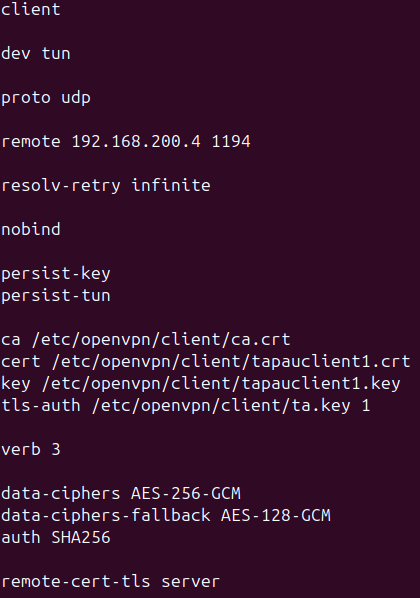
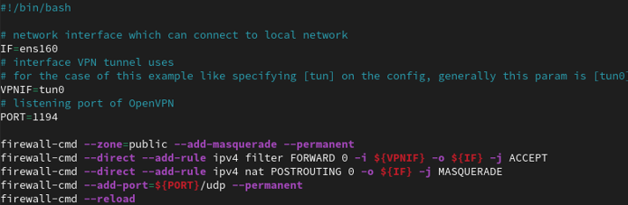
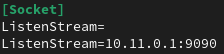
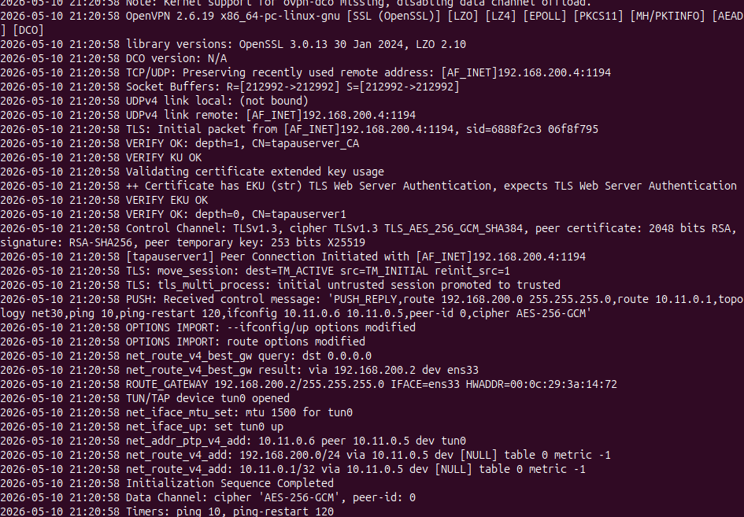
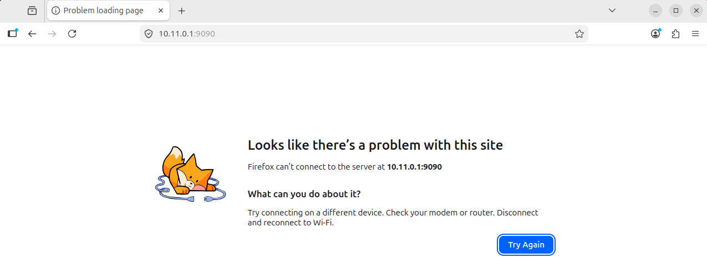
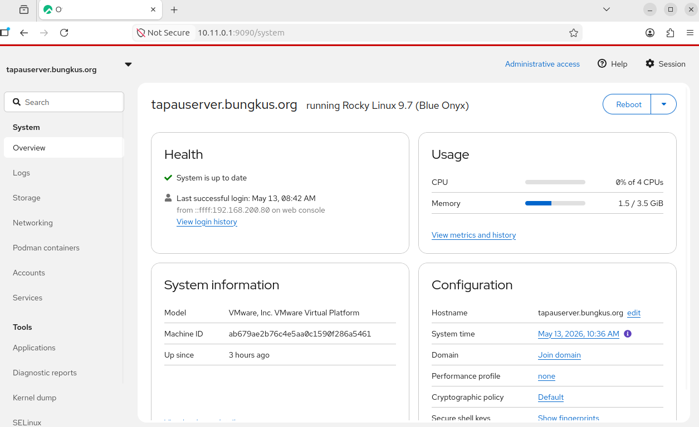

# 05 OpenVPN and Cockpit

## Purpose

This runbook sets up an OpenVPN server on Rocky Linux 9.7 and connects the Ubuntu 24.04 client to it, then restricts the Cockpit web console to the tunnel address. Without the VPN the client cannot reach Cockpit on either the LAN address or the tunnel address. With the VPN up, Cockpit answers on `10.11.0.1:9090`.

## Environment

| Item | Value |
|---|---|
| Server | Rocky Linux 9.7, hostname `tapauserver.bungkus.org`, 192.168.200.4 |
| Client | Ubuntu 24.04.4, hostname `tapauclient.bungkus.org`, 192.168.200.80 (DHCP) |
| VPN subnet | 10.11.0.0/24, server `10.11.0.1`, UDP port 1194 |
| Packages | Server: `epel-release`, `openvpn` 2.5.11, `easy-rsa` 3.2.1, `net-tools`, `cockpit` 344. Client: `openvpn` 2.6.19 |
| Certificate names | CA `tapauserver_CA`, server `tapauserver1`, client `tapauclient1` |
| Domain | `bungkus.org` (fictional) |

The server interface is `ens160` in the VPN section and the report's Cockpit pages show a VMware host, while the other runbooks in this repo use `enp0s3` on VirtualBox. These sections were done on a different VM setup. The scripts below use `ens160`, as the report does. Change `IF=` to match your interface.

## Steps

### Server: install and build the PKI

1. EPEL must come first, because OpenVPN is not in the default Rocky repos.
   ```bash
   sudo dnf install -y epel-release
   sudo dnf --enablerepo=epel -y install openvpn easy-rsa net-tools
   ```
2. Create the PKI and the CA. The CA key is protected by a passphrase; use your own (CHANGE_ME).
   ```bash
   cd /usr/share/easy-rsa/3
   sudo ./easyrsa init-pki
   sudo ./easyrsa build-ca
   ```
3. Issue the server and client certificates. `nopass` leaves their keys unencrypted. Signing asks for the CA passphrase.
   ```bash
   sudo ./easyrsa build-server-full tapauserver1 nopass
   sudo ./easyrsa build-client-full tapauclient1 nopass
   ```
4. Generate the Diffie-Hellman parameters and the TLS-auth key. The key adds an HMAC check on every packet, which drops unauthorized traffic early.
   ```bash
   sudo ./easyrsa gen-dh
   sudo openvpn --genkey secret ./pki/ta.key
   ```
5. Copy the PKI files to where OpenVPN reads them.
   ```bash
   sudo cp -pR /usr/share/easy-rsa/3/pki/{issued,private,ca.crt,dh.pem,ta.key} /etc/openvpn/server/
   ```

### Server: OpenVPN configuration

6. Start from the sample config and edit it (see Configuration).
   ```bash
   sudo cp /usr/share/doc/openvpn/sample/sample-config-files/server.conf /etc/openvpn/server/
   sudo nano /etc/openvpn/server/server.conf
   ```
7. Create the two firewall scripts that open and close the forwarding rules, and make them executable by root only.
   ```bash
   sudo nano /etc/openvpn/server/add-bridge.sh
   sudo nano /etc/openvpn/server/remove-bridge.sh
   sudo chmod 700 /etc/openvpn/server/{add-bridge.sh,remove-bridge.sh}
   ```
8. Hook the scripts into the service with a systemd drop-in. `systemctl edit` fails until the directory exists (see Troubleshooting).
   ```bash
   sudo mkdir -p /etc/systemd/system/openvpn-server@server.service.d
   sudo nano /etc/systemd/system/openvpn-server@server.service.d/override.conf
   sudo systemctl daemon-reload
   ```
9. Start the service and enable it at boot.
   ```bash
   sudo systemctl enable --now openvpn-server@server
   ```

### Move the client files to Ubuntu

10. Copy the CA certificate, TLS key and client certificate and key to the admin user's home, take ownership, and fetch them over SFTP. The report enabled `vsftpd` for this.
    ```bash
    sudo systemctl enable --now vsftpd
    sudo cp /etc/openvpn/server/{ca.crt,ta.key,issued/tapauclient1.crt,private/tapauclient1.key} ~/
    sudo chown "$USER:$USER" ~/ca.crt ~/ta.key ~/tapauclient1.crt ~/tapauclient1.key
    ```
    On the client:
    ```bash
    sftp USER@192.168.200.4
    sftp> get ca.crt
    sftp> get ta.key
    sftp> get tapauclient1.crt
    sftp> get tapauclient1.key
    ```
    Then delete the copies from the server home so the client key does not stay lying around.
    ```bash
    sudo rm ~/ca.crt ~/ta.key ~/tapauclient1.crt ~/tapauclient1.key
    ```

### Client: install and connect

11. Install OpenVPN and put the files where the client config expects them.
    ```bash
    sudo apt update -y
    sudo apt install openvpn
    sudo mkdir -p /etc/openvpn/client
    sudo cp ~/ca.crt ~/ta.key ~/tapauclient1.crt ~/tapauclient1.key /etc/openvpn/client/
    ```
12. Write `client.conf` (see Configuration), then start and enable the client service.
    ```bash
    sudo nano /etc/openvpn/client/client.conf
    sudo systemctl enable openvpn-client@client
    sudo systemctl start openvpn-client@client
    sudo systemctl status openvpn-client@client
    ```

### Cockpit on the tunnel only

13. Make sure Cockpit is installed and its socket and firewall service are on. It was already installed in the report.
    ```bash
    sudo dnf install -y cockpit
    sudo systemctl enable --now cockpit.socket
    sudo firewall-cmd --add-service=cockpit --permanent
    sudo firewall-cmd --reload
    ```
14. Before restricting it, the report logged in at `https://192.168.200.4:9090` from the client to prove Cockpit works.
15. Restrict the listener. The empty `ListenStream=` clears the default, then the tunnel address is added.
    ```bash
    sudo mkdir -p /etc/systemd/system/cockpit.socket.d
    sudo nano /etc/systemd/system/cockpit.socket.d/listen.conf
    sudo systemctl daemon-reload
    sudo systemctl restart cockpit.socket
    ```

## Configuration

- [server.conf](../configs/05-openvpn-cockpit/server.conf): partial. Only the edited lines: certificate paths, `server 10.11.0.0 255.255.255.0`, `keepalive 10 120`, `tls-auth ta.key 0`, logging, `verb 3`, `explicit-exit-notify 1`, and `data-ciphers AES-256-GCM` with an AES-128-GCM fallback and `auth SHA256`.
- [client.conf](../configs/05-openvpn-cockpit/client.conf): complete. Mirrors the server ciphers and adds `remote-cert-tls server` so the client checks the server certificate.
- [add-bridge.sh](../configs/05-openvpn-cockpit/add-bridge.sh) and [remove-bridge.sh](../configs/05-openvpn-cockpit/remove-bridge.sh): firewalld masquerade, a forward rule from `tun0` to `ens160`, and UDP 1194. The add script is the revised version that was running when the service started; see Troubleshooting.
- [openvpn-server-override.conf](../configs/05-openvpn-cockpit/openvpn-server-override.conf): the drop-in that runs the scripts with `ExecStartPost` and `ExecStopPost`.
- [cockpit-listen.conf](../configs/05-openvpn-cockpit/cockpit-listen.conf): the `ListenStream` override.
- [easyrsa-commands.sh](../configs/05-openvpn-cockpit/easyrsa-commands.sh): the PKI commands in order. The report shows no `vars` file, so easy-rsa defaults were used.

The report's screenshots of these steps show no key or certificate contents, and none are in this repo.


*The final `client.conf` on the Ubuntu client.*


*The first draft of `add-bridge.sh`, with the `--permanent` flags and the final reload.*


*`listen.conf` limiting Cockpit to `10.11.0.1:9090`.*

## Verification

- On the client, `systemctl status openvpn-client@client` showed `active (running)` and "Initialization Sequence Completed". The tunnel address was `10.11.0.6` with peer `10.11.0.5`, cipher `AES-256-GCM`.
- The client log showed `VERIFY OK` for both the CA (`tapauserver_CA`) and the server certificate (`tapauserver1`), and no warnings after the `client.conf` fix.
- The server had `tun0` at `10.11.0.1`. Pings from the server to `10.11.0.6`, `192.168.200.80` and `tapauclient.bungkus.org` had 0% loss, and so did pings from the client to `10.11.0.1`, `192.168.200.4` and `tapauserver.bungkus.org`. `dig` for each host name returned `NOERROR` with one answer.
- With the client VPN stopped (`sudo systemctl stop openvpn-client@client`), Firefox could not connect to `192.168.200.4:9090` or `10.11.0.1:9090`.
- With the VPN started again, `10.11.0.1:9090` loaded the Cockpit overview for `tapauserver.bungkus.org`. Cockpit showed the login as coming from 192.168.200.80.


*Client log: certificates verified, tunnel `tun0` up at 10.11.0.6, "Initialization Sequence Completed".*


*With the VPN stopped, `10.11.0.1:9090` does not connect.*


*Cockpit loaded at `10.11.0.1:9090` after the VPN was started.*

Note on addresses: the client's DNS answers in the report are inconsistent. A `dig` run on the server returned 192.168.200.128 for `tapauclient.bungkus.org`, while its `ping` of the same name resolved to 192.168.200.80. Treat 192.168.200.80 as the client address.

## Troubleshooting

**`Unknown repo: 'epel'` when installing OpenVPN.**
- Cause: OpenVPN is not in the Rocky 9 base repos.
- Fix: `sudo dnf install -y epel-release`, then rerun the install.

**`systemctl edit openvpn-server@server` fails with "No such file or directory".**
- Cause: the `.service.d` directory did not exist.
- Fix: `sudo mkdir -p /etc/systemd/system/openvpn-server@server.service.d`, create `override.conf` there, then `sudo systemctl daemon-reload`.

**Client log shows "No route to host" and a TLS handshake timeout.**
- The client could ping 192.168.200.4 and `nc -vzu 192.168.200.4 1194` succeeded, so the network was fine. The server service was not running.
- Fix: see the next two items.

**Server service fails to start, status shows `203/EXEC` on `add-bridge.sh` ("Permission denied").**
- The report first tried `chcon -t openvpn_exec_t` and then `chcon -t bin_t` on both scripts, with no visible change.
- What changed the result: `head -1` on the script showed a `# create new` comment as its first line, so there was no shebang. The report removed that line and rewrote the script (the revised version dropped `--permanent` and `--reload`). The service then started. The report does not separate the effect of the `chcon` commands from the edit, so check the shebang first.

**Client warns about compression and `--cipher AES-256-CBC` missing from `--data-ciphers`, and "No server certificate verification method".**
- Fix: remove `comp-lzo` from both configs, replace `cipher AES-256-CBC` with `data-ciphers AES-256-GCM` plus `data-ciphers-fallback AES-128-GCM`, and add `remote-cert-tls server` to the client. Restart both services.

**Server cannot ping the client after the tunnel is up.**
- Cause: the client had a second route for 192.168.200.0/24 through the tunnel, next to its LAN route.
- Fix: comment out `push "route 192.168.200.0 255.255.255.0"` in `server.conf`, restart the server service, then restart the client service. `ip route show` on the client then listed only the LAN route.

## Security notes

- The client and server keys were moved by SFTP using password login, and the report deleted the copies from the server home afterward. Use a CA passphrase of your own (CHANGE_ME), and do not commit the PKI.
- `nopass` leaves the server and client private keys unencrypted on disk.
- Firefox marks the Cockpit page at `10.11.0.1:9090` as "Not Secure" in the report's screenshot. The report does not say why, so check the Cockpit certificate before relying on it.
- The report enabled `vsftpd` and describes it as the SFTP service, but vsftpd is an FTP daemon; SFTP is provided by `sshd`. The `sftp` transfer in the report ran over SSH.
