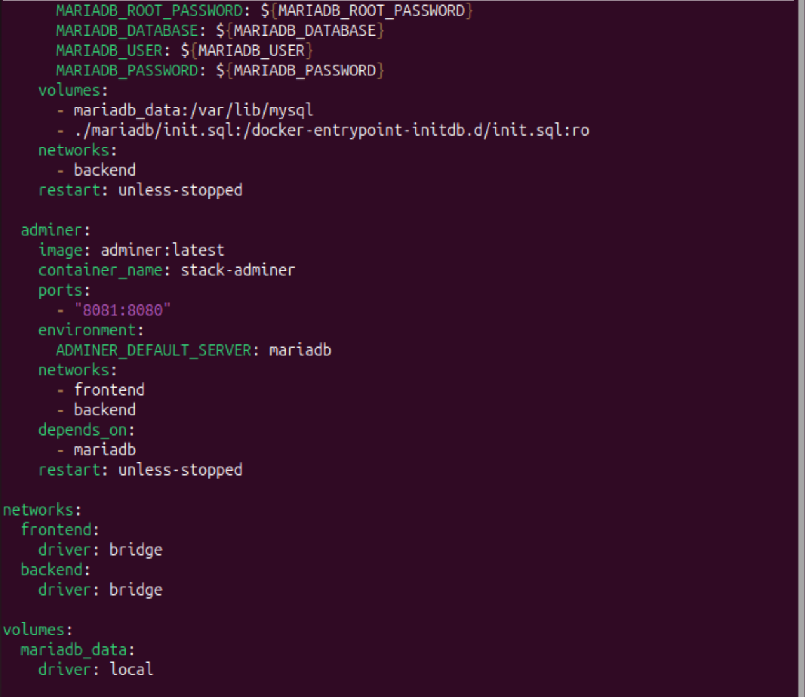
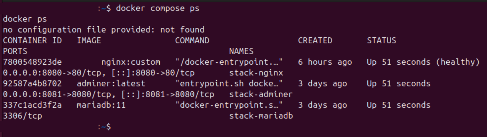
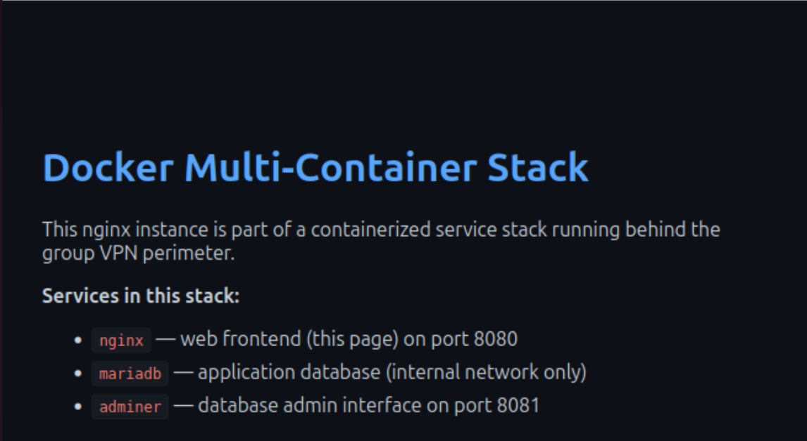
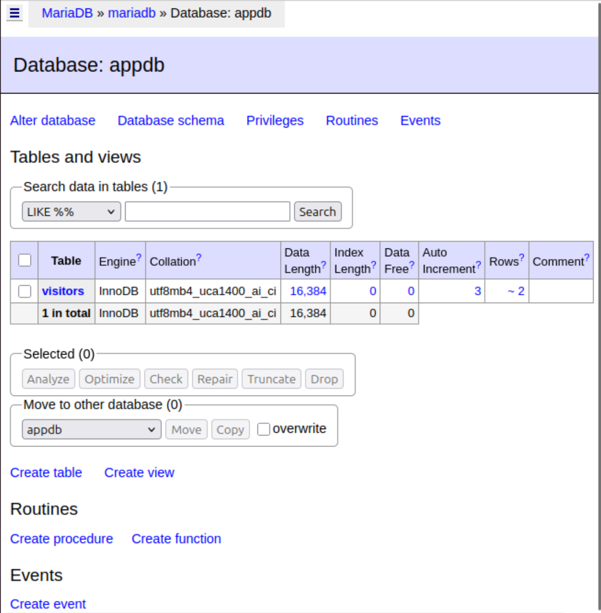
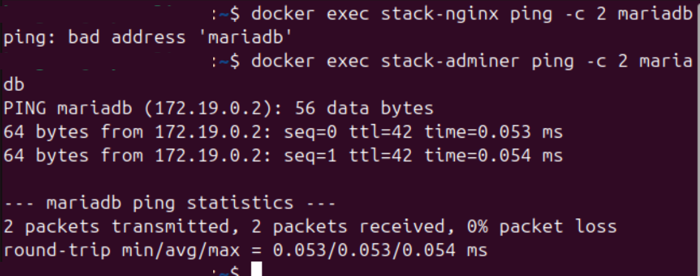

# 06 - Docker Compose multi-container stack

This lab runs three containers with Docker Compose: nginx (built from a custom multi-stage Dockerfile), MariaDB 11 and Adminer. Two bridge networks split them into a frontend and a backend tier, a named volume keeps the database files, and credentials come from a `.env` file. The aim is to show Compose orchestration, DNS-based service discovery between containers, network segmentation and persistent storage.

## Environment

| Item | Value |
| --- | --- |
| Docker host | Ubuntu client `tapauclient.bungkus.org`, 192.168.200.80, Ubuntu 24.04.4 LTS (VirtualBox VM) |
| Kernel | 6.17.0-23-generic |
| Docker | Docker CE 29.4.2 from Docker's official APT repo, Compose plugin v5.1.3 |
| Lab server | `tapauserver.bungkus.org`, 192.168.200.3, Rocky Linux 9.7 (listed in the report's environment table; the Docker work was done on the Ubuntu client, as every prompt shows) |
| Images | `nginx:1.27-alpine` (final) on `alpine:3.19` (build stage), `mariadb:11`, `adminer:latest` |

The report says the host sits behind a VPN gateway run by another group member, with UFW and Fail2ban covered in other chapters. Those parts are not configured here.

## Steps

### 1. Install Docker CE from the official repository

The `docker.io` package in Ubuntu's repos lags behind, and the Compose plugin is needed.

```bash
sudo apt remove -y docker docker-engine docker.io containerd runc 2>/dev/null
sudo apt update
sudo apt install -y ca-certificates curl gnupg
sudo install -m 0755 -d /etc/apt/keyrings
sudo curl -fsSL https://download.docker.com/linux/ubuntu/gpg -o /etc/apt/keyrings/docker.asc
sudo chmod a+r /etc/apt/keyrings/docker.asc
echo \
"deb [arch=$(dpkg --print-architecture) signed-by=/etc/apt/keyrings/docker.asc] https://download.docker.com/linux/ubuntu \
$(. /etc/os-release && echo "$VERSION_CODENAME") stable" | \
sudo tee /etc/apt/sources.list.d/docker.list > /dev/null
sudo apt update
sudo apt install -y docker-ce docker-ce-cli containerd.io docker-buildx-plugin docker-compose-plugin
```

The first line removes conflicting packages (none were installed). The key and repo lines let `apt` verify Docker's packages.

### 2. Start Docker and check it

```bash
sudo systemctl start docker.socket
sudo systemctl start docker.service
sudo systemctl enable docker.service
sudo systemctl enable docker.socket
sudo systemctl status docker
sudo docker run hello-world
docker --version
docker compose version
```

Enabling both units makes Docker start at boot. `hello-world` proves the daemon can pull and run an image.

### 3. Let the user run docker without sudo

```bash
sudo usermod -aG docker $USER
```

Without this, every `docker` command needs sudo. Group changes only apply to new logins; see Troubleshooting.

### 4. Create the project layout

```bash
mkdir -p ~/docker-stack/nginx/html
mkdir -p ~/docker-stack/mariadb
cd ~/docker-stack
```

Resulting layout (mirrored in `configs/06-docker-compose/`, with `.env.example` standing in for the real `.env`):

```text
docker-stack/
├── docker-compose.yml
├── .env
├── .gitignore
├── nginx/
│   ├── Dockerfile
│   ├── nginx.conf
│   └── html/
│       └── index.html
└── mariadb/
    └── init.sql
```

### 5. Create the `.env` file and protect it

```bash
nano ~/docker-stack/.env
chmod 600 ~/docker-stack/.env
echo ".env" > .gitignore
```

The file holds the four `MARIADB_*` variables (see `.env.example`). `chmod 600` limits it to the owner, and `.gitignore` keeps it out of version control.

### 6. Write the Compose file, Dockerfile, nginx.conf, landing page and init script

Each file was created with `nano`. Contents are in the Configuration section and in `configs/06-docker-compose/`.

### 7. Validate the Compose file

```bash
cat docker-compose.yml
docker compose config
```

`docker compose config` prints the file with the `.env` variables substituted. It confirmed the variables were picked up, the two networks and volume were named `docker-stack_*`, and the ports were published as 8080 and 8081. (The output shows the real passwords in clear text, so it should not be pasted into public places.)

### 8. Build and start the stack

```bash
docker compose build
docker compose up -d
docker compose ps
```

`build` creates the custom nginx image. `up -d` pulls MariaDB and Adminer, creates both networks and the volume, and starts the three containers in the background.

### 9. Test and inspect

```bash
curl -I http://localhost:8080
curl -I http://localhost:8081
docker images
docker network ls
docker network inspect docker-stack_frontend
docker network inspect docker-stack_backend
docker volume ls
docker exec stack-nginx ping -c 2 mariadb
docker exec stack-adminer ping -c 2 mariadb
```

The two `ping` commands test the network segmentation.

## Configuration

| File | Key settings |
| --- | --- |
| [docker-compose.yml](../configs/06-docker-compose/docker-compose.yml) | `nginx` publishes `8080:80` on `frontend` only. `mariadb` publishes nothing and is on `backend` only. `adminer` publishes `8081:8080` and is on both networks, with `ADMINER_DEFAULT_SERVER: mariadb`. All use `restart: unless-stopped`. Data lives in the named volume `mariadb_data` at `/var/lib/mysql`. |
| [.env.example](../configs/06-docker-compose/.env.example) | `MARIADB_ROOT_PASSWORD`, `MARIADB_DATABASE=appdb`, `MARIADB_USER=appuser`, `MARIADB_PASSWORD`. Passwords are `CHANGE_ME` here. |
| [nginx/Dockerfile](../configs/06-docker-compose/nginx/Dockerfile) | Stage 1 (alpine) runs `envsubst` to write `BUILD_DATE` and `BUILD_HOST` into `index.html`. Stage 2 is `nginx:1.27-alpine` with the default site removed, the custom `nginx.conf`, a `nginx -t` check at build time, and a `HEALTHCHECK` using `wget` against `127.0.0.1`. |
| [nginx/nginx.conf](../configs/06-docker-compose/nginx/nginx.conf) | `server_tokens off`; headers `X-Frame-Options`, `X-Content-Type-Options`, `X-XSS-Protection`, `Referrer-Policy`; dotfiles denied with `location ~ /\.`. |
| [nginx/html/index.html](../configs/06-docker-compose/nginx/html/index.html) | Dark landing page listing the three services, with `$BUILD_DATE` and `$BUILD_HOST` placeholders filled at build time. |
| [mariadb/init.sql](../configs/06-docker-compose/mariadb/init.sql) | Creates a `visitors` table and inserts two rows. It runs once, on first start of an empty volume, because it is mounted into `/docker-entrypoint-initdb.d/`. |
| [.gitignore](../configs/06-docker-compose/.gitignore) | Ignores `.env`. |

Two values from the report are changed in the published files: the image tag `kong-nginx:custom` and build host `docker-host-kong` carry the author's name, so they appear as `lab-nginx:custom` and `docker-host-lab`. The report's page title also contained the name and is shortened to "Docker Stack". The `.env.example` and the nginx files are otherwise as shown. See the comment at the top of each file.



*The lower half of `docker-compose.yml` in nano: Adminer on both networks, then the two bridge networks and the volume.*

## Verification

- `docker compose config` showed the resolved file with both `docker-stack_*` networks and the `docker-stack_mariadb_data` volume.
- `docker compose up -d` created both networks, the volume and the three containers.
- `docker compose ps` listed `stack-nginx` as `(healthy)`, `stack-adminer` on 8081 and `stack-mariadb` with only `3306/tcp` (not published to the host).



*Three containers up, nginx healthy, MariaDB not published to the host. The image name prefix and prompt are masked.*

- `curl -I http://localhost:8080` returned `200 OK` with `Server: nginx` (no version) and the four security headers. `curl -I http://localhost:8081` returned `200 OK` from Adminer with `X-Powered-By: PHP/8.4.20`.
- Firefox at `http://localhost:8080` showed the landing page with the injected build timestamp and host.



*The landing page served by the custom nginx image on port 8080.*

- Adminer at `http://localhost:8081` accepted the login (server `mariadb`, user `appuser`, database `appdb`) and showed one table, `visitors`, with about 2 rows, which matches `init.sql`.



*Adminer connected to MariaDB over the backend network, showing the `visitors` table created by the init script.*

- Segmentation test: `docker exec stack-nginx ping -c 2 mariadb` failed with `bad address 'mariadb'`, because nginx is only on `frontend`. The same command from `stack-adminer` succeeded (172.19.0.2, 0% loss), because Adminer is on both networks.



*nginx cannot resolve `mariadb`; Adminer can reach it. The shell prompt is masked.*

## Troubleshooting

### Permission denied on the Docker socket

`docker compose build` failed with `permission denied while trying to connect to the docker API at unix:///var/run/docker.sock`. The user had been added to the `docker` group earlier, but group membership is read at login, so the open terminal still had the old groups.

Fix: start a shell with the group applied (logging out and back in also works), then rebuild.

```bash
newgrp docker
docker ps
cd ~/docker-stack
docker compose build
```

`docker ps` ran without error and the build started.

### nginx container shows (unhealthy)

`docker compose ps` showed `stack-nginx` as `(unhealthy)` while the site still answered on port 8080. The health log (`docker inspect --format='{{json .State.Health}}' stack-nginx`) showed `FailingStreak: 63` and `wget: can't connect to remote host: Connection refused`.

Diagnosis:

```bash
docker exec stack-nginx netstat -tlnp 2>/dev/null || docker exec stack-nginx ss -tlnp
docker exec stack-nginx wget -O- http://127.0.0.1/ 2>&1 | head -10
docker exec stack-nginx wget -O- http://localhost/ 2>&1 | head -10
```

nginx was listening on `0.0.0.0:80`. `wget` to `127.0.0.1` returned the page, but `localhost` resolved to `[::1]` and was refused. The `nginx.conf` only has `listen 80;` (IPv4), so nothing answers on IPv6.

Fix: change the `HEALTHCHECK` in the Dockerfile from `http://localhost/` to `http://127.0.0.1/`, then rebuild and recreate the container.

```bash
docker compose build nginx
docker compose up -d
docker compose ps
```

After this, `stack-nginx` showed `(healthy)`. Adding `listen [::]:80;` would be the other fix; the report did not try it.

### Minor: `docker compose ps` run outside the project directory

One capture shows `no configuration file provided: not found` because the command ran from `~` instead of `~/docker-stack`. `docker ps` in the same capture still worked. Run Compose commands from the project directory, or pass `-f`.

## Security notes on the original setup

- The report used `SNA1234` for both the MariaDB root and application passwords. Weak and identical. This repo uses `CHANGE_ME` placeholders; set strong, different values.
- `docker compose config` prints those values in clear text, and the report pasted that output.
- Adminer is published on all host interfaces (`0.0.0.0:8081`) and uses `adminer:latest`, an unpinned tag. Restrict it to localhost or the VPN side, and pin a version, for anything beyond a lab.
- Adminer's login form had "Permanent login" ticked in the screenshot.
- `nginx` has `depends_on: adminer`, which is not a real dependency; it only affects start order.
- `X-XSS-Protection` is a legacy header that current browsers ignore.
- Adding a user to the `docker` group gives that user root-equivalent control of the host.
