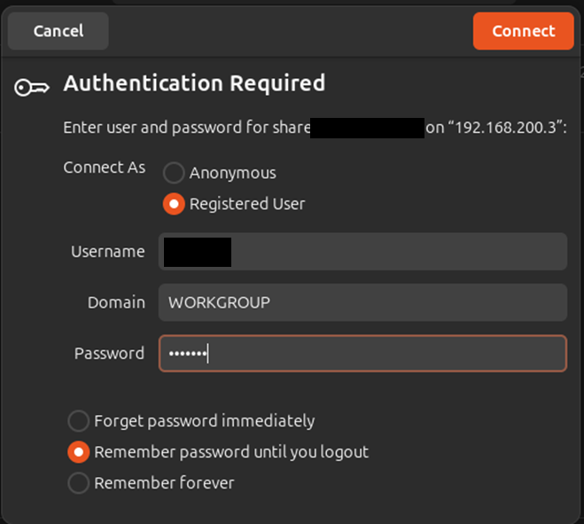
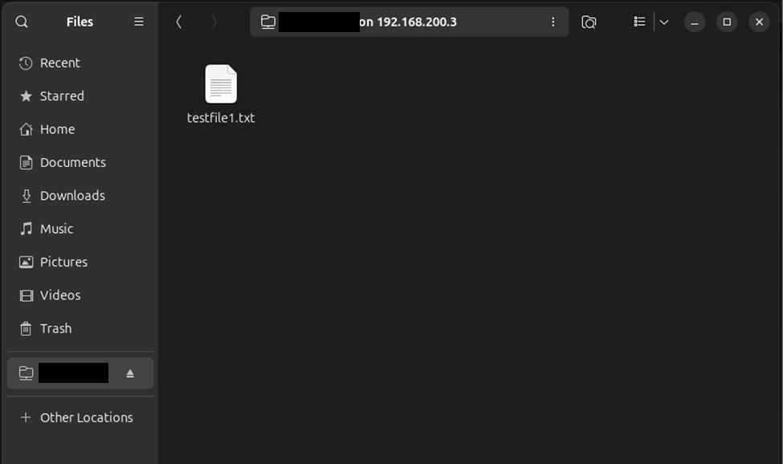
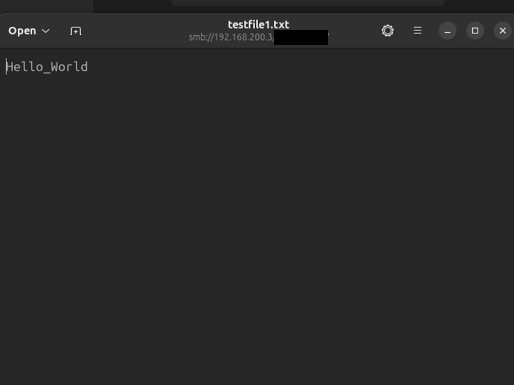

# 07 File sharing (Samba)

## Purpose

This runbook publishes one directory from the Rocky Linux 9.7 server as an authenticated Samba (SMB) share and mounts it from the Ubuntu client's file manager. Guest access is off, so a Samba password is required. A file created on the server is then opened from the client to show the share works.

## Environment

| Item | Value |
|---|---|
| Server | Rocky Linux 9.7, hostname `tapauserver.bungkus.org`, 192.168.200.3, interface `enp0s3` |
| Client | Ubuntu 24.04.4, hostname `tapauclient.bungkus.org`, 192.168.200.80 |
| Packages | `samba`, `samba-client` (4.22.4 in the report) |
| Share | `[LabShare]`, path `/srv/samba/lab_share`, user `labuser` |
| Services | `smb`, `nmb` |
| Domain | `bungkus.org` (fictional) |

The report used a team member's first name for the OS user, the share name and the directory. They are renamed here to `labuser`, `LabShare` and `lab_share`. The Samba password is not recorded; set your own (CHANGE_ME).

This section's outputs show the server at 192.168.200.3. Other sections of the report show it at 192.168.200.4. Use the address your server has.

## Steps

1. Install Samba and its client tools.
   ```bash
   sudo dnf install samba samba-client -y
   ```
2. Create a share directory under `/srv`, which is the standard place for data a service serves. Give it to the share user and set mode 755.
   ```bash
   sudo mkdir -p /srv/samba/lab_share
   sudo chown -R labuser:labuser /srv/samba/lab_share
   sudo chmod -R 755 /srv/samba/lab_share
   ```
   The OS account `labuser` must already exist. The report used an existing account and does not show it being created.
3. Give the user a Samba password. Samba keeps its own password database, separate from the Linux password.
   ```bash
   sudo smbpasswd -a labuser
   ```
4. Back up `smb.conf`, then add the share at the end of the file (see Configuration). `valid users` and `guest ok = no` are what force a login. The report says it made a backup but does not show the command.
   ```bash
   sudo cp -p /etc/samba/smb.conf /etc/samba/smb.conf.bak
   sudo nano /etc/samba/smb.conf
   ```
5. Open the firewall for Samba and start both daemons so they run at boot. `smb` serves files; `nmb` handles NetBIOS name service.
   ```bash
   sudo firewall-cmd --permanent --add-service=samba
   sudo firewall-cmd --reload
   sudo systemctl enable --now smb nmb
   ```
6. Label the directory so SELinux (Enforcing on Rocky) lets `smbd` use it.
   ```bash
   sudo chcon -t samba_share_t /srv/samba/lab_share
   ```
7. On the Ubuntu client open Files, Other Locations, and connect to the server. Choose "Registered User", enter `labuser`, the Samba password and the domain `WORKGROUP`.
   ```
   smb://192.168.200.3/LabShare
   ```
8. On the server create a test file in the share, then open it from the client.
   ```bash
   cd /srv/samba/lab_share
   nano testfile1.txt
   ```

## Configuration

- [smb.conf](../configs/07-samba/smb.conf): partial. Only the tail of the file is legible in the report: the stock `[printers]` and `[print$]` sections and the added `[LabShare]` share with `valid users = labuser`, `writable = yes`, `browsable = yes`, `guest ok = no`. The `[global]` section is not shown. The report text also gives a `comment = Secure Share ...` line that the screenshot does not show.
- [setup-commands.sh](../configs/07-samba/setup-commands.sh): all server-side commands in order, with the renamed user and directory.


*The GNOME authentication dialog for the share on 192.168.200.3, with "Registered User" selected. The user and share names are blacked out.*

## Verification

- Each service command returned `success` or created the expected symlinks; both `smb` and `nmb` were enabled and started.
- The client asked for credentials when connecting to `smb://192.168.200.3/` plus the share name, and accepted the user and Samba password. The share opened and showed "Folder is Empty".
- After `testfile1.txt` was created on the server, it appeared in the client's view. Opening it showed the text `Hello_World`.


*The mounted share on 192.168.200.3 showing `testfile1.txt`; the share name is blacked out.*


*`testfile1.txt` opened from the share path, showing `Hello_World`.*

The report labels the first test "synchronization". It only tests reading: the file was created on the server and read on the client. Writing from the client to the share was not tested.

## Troubleshooting

The report records no problems for this service.

## Notes

- Access control is by `valid users` and `guest ok = no`. There is no `hosts allow`, and the `[global]` section is not shown, so settings such as the minimum SMB protocol, signing or encryption cannot be checked from the report.
- `chcon` is not persistent. A full filesystem relabel (`restorecon -R`) or `fixfiles` would reset the label. `semanage fcontext -a -t samba_share_t "/srv/samba/lab_share(/.*)?"` followed by `restorecon -Rv` survives a relabel. The web runbook uses that form.
- Mode 755 owned by `labuser` means only that user can write. Other users can read the directory over SMB only if they are in `valid users`, and none are.
- The client dialog offers "Remember password until you logout"; the report chose it. The password field in the screenshot is masked.
- `nmb` is enabled although the client connected by IP address. Name browsing was not tested.
- Port 139 and 445 are opened by the `samba` firewalld service to every host that can reach the server; the report applies no source restriction.
