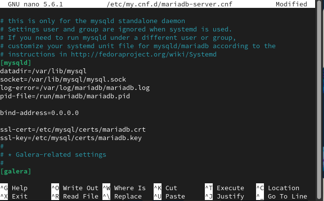
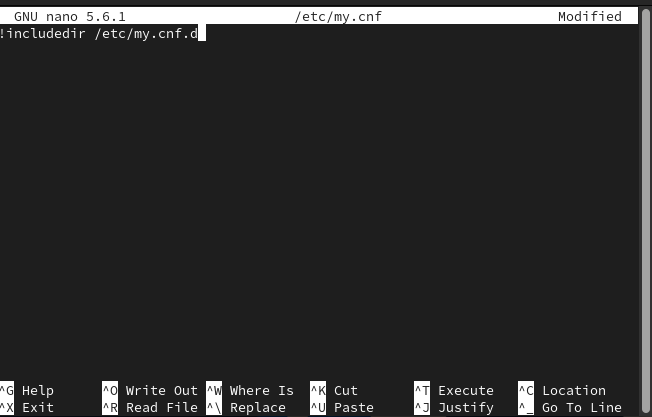
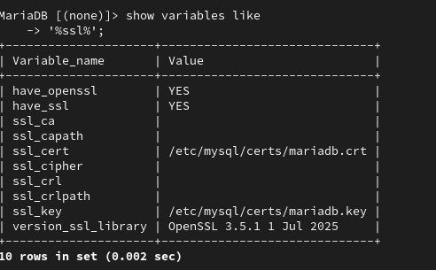
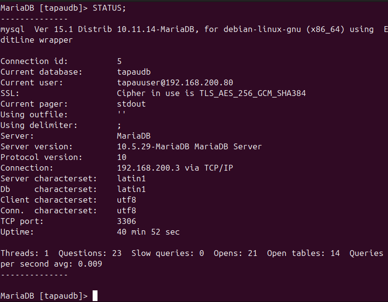
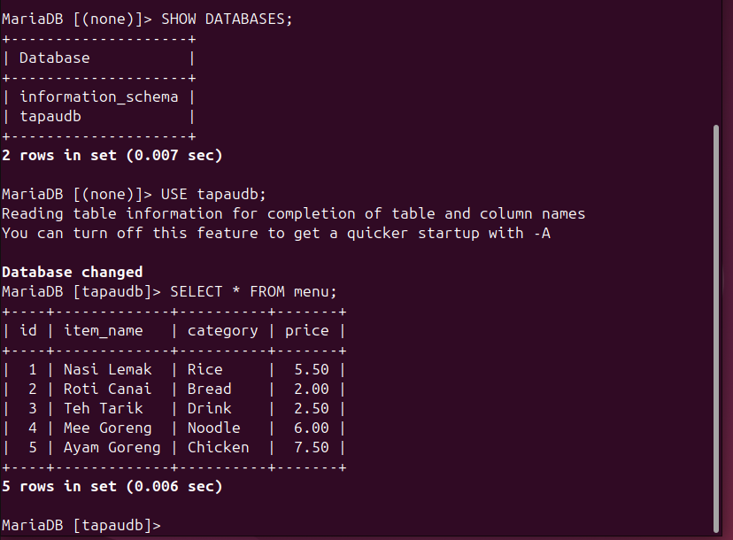

# 08 Database server (MariaDB with TLS)

## Purpose

This runbook installs MariaDB on Rocky Linux 9.7, creates a sample database and a user that may connect from any host, turns on TLS with a self-signed certificate, and requires TLS for that user. The Ubuntu client then connects over the network and queries the sample table. It also covers the case where MariaDB ignored the TLS settings because `/etc/my.cnf` did not include the `my.cnf.d` directory.

## Environment

| Item | Value |
|---|---|
| Server | Rocky Linux 9.7, hostname `tapauserver.bungkus.org`, 192.168.200.3, interface `enp0s3` |
| Client | Ubuntu 24.04.4, hostname `tapauclient.bungkus.org`, 192.168.200.80 |
| Packages | Server: `mariadb-server` 10.5.29. Client: `mariadb-client` (client binary reported as 10.11.14) |
| Database | `tapaudb`, table `menu` |
| Database user | `tapauuser`, from `localhost` and from `%` |
| Port | 3306/tcp via the firewalld `mysql` service |
| TLS library | OpenSSL 3.5.1 |
| Domain | `bungkus.org` (fictional) |

The report used one password for both the MariaDB root user and `tapauuser`. It is replaced everywhere here with CHANGE_ME. Use different strong passwords of your own.

## Steps

1. Install MariaDB, enable it at boot and start it now, then check it is running.
   ```bash
   sudo dnf install mariadb-server -y
   sudo systemctl enable --now mariadb
   sudo systemctl status mariadb
   ```
2. Open the MariaDB port so the client can connect.
   ```bash
   sudo firewall-cmd --permanent --add-service=mysql
   sudo firewall-cmd --reload
   sudo firewall-cmd --list-all
   ```
3. Run the hardening script. The report answered: no password at the first prompt (Enter), no to unix_socket authentication, yes to changing the root password (use CHANGE_ME), then yes to removing anonymous users, disallowing remote root login, removing the test database, and reloading privileges.
   ```bash
   sudo mysql_secure_installation
   ```
4. Log in as root and create the user, database, table and sample rows (see `setup.sql`).
   ```bash
   sudo mysql -u root -p
   ```
   ```sql
   CREATE USER 'tapauuser'@'localhost' IDENTIFIED BY 'CHANGE_ME';
   CREATE USER 'tapauuser'@'%' IDENTIFIED BY 'CHANGE_ME';
   FLUSH PRIVILEGES;
   CREATE DATABASE tapaudb;
   GRANT ALL PRIVILEGES ON tapaudb.* TO 'tapauuser'@'localhost';
   GRANT ALL PRIVILEGES ON tapaudb.* TO 'tapauuser'@'%';
   FLUSH PRIVILEGES;
   USE tapaudb;
   CREATE TABLE menu (
     id INT AUTO_INCREMENT PRIMARY KEY,
     item_name VARCHAR(100) NOT NULL,
     category VARCHAR(50),
     price DECIMAL(5,2) NOT NULL
   );
   INSERT INTO menu (item_name, category, price) VALUES
     ('Nasi Lemak', 'Rice', 5.50),
     ('Roti Canai', 'Bread', 2.00),
     ('Teh Tarik', 'Drink', 2.50),
     ('Mee Goreng', 'Noodle', 6.00),
     ('Ayam Goreng', 'Chicken', 7.50);
   ```
5. Create a directory for the certificate, generate a self-signed certificate and key (`-nodes`: no passphrase), and set permissions. MariaDB runs as `mysql`, so that user must own the files and the key must not be world-readable.
   ```bash
   sudo mkdir -p /etc/mysql/certs
   sudo openssl req -x509 -nodes \
     -keyout /etc/mysql/certs/mariadb.key \
     -out /etc/mysql/certs/mariadb.crt \
     -days 365 -newkey rsa:2048
   sudo chmod 644 /etc/mysql/certs/mariadb.crt
   sudo chmod 600 /etc/mysql/certs/mariadb.key
   sudo chown -R mysql:mysql /etc/mysql/certs/
   ```
   The prompt answers are listed in `openssl-selfsigned-cert.sh`; the Common Name was `tapauserver.bungkus.org`.
6. Under `[mysqld]` in `/etc/my.cnf.d/mariadb-server.cnf`, add the listen address and the certificate paths, then restart.
   ```bash
   sudo nano /etc/my.cnf.d/mariadb-server.cnf
   sudo systemctl restart mariadb
   ```
7. Check whether TLS is on. In the report this showed `have_ssl = DISABLED` at first; see Troubleshooting for the fix.
   ```sql
   SHOW VARIABLES LIKE '%ssl%';
   ```
8. Require TLS for the user.
   ```sql
   ALTER USER 'tapauuser'@'localhost' REQUIRE SSL;
   ALTER USER 'tapauuser'@'%' REQUIRE SSL;
   FLUSH PRIVILEGES;
   ```
9. On the Ubuntu client install the client package, connect, and run the checks (see Verification).
   ```bash
   sudo apt install mariadb-client -y
   mysql -u tapauuser -p -h 192.168.200.3
   ```

## Configuration

- [mariadb-server.cnf](../configs/08-mariadb-tls/mariadb-server.cnf): the `[mysqld]` section with the three added lines `bind-address=0.0.0.0`, `ssl-cert` and `ssl-key`. Partial: only what the screenshot shows.
- [my.cnf](../configs/08-mariadb-tls/my.cnf): the single line `!includedir /etc/my.cnf.d` that made the server read the file above. The rest of the file is not shown in the report.
- [openssl-selfsigned-cert.sh](../configs/08-mariadb-tls/openssl-selfsigned-cert.sh): directory, certificate command, prompt answers, permissions. The key is not in this repo.
- [setup.sql](../configs/08-mariadb-tls/setup.sql): users, database, table, sample rows and `REQUIRE SSL`, with the password replaced by CHANGE_ME.


*The `[mysqld]` section with `bind-address` and the two `ssl-` lines added.*


*`/etc/my.cnf` containing only `!includedir /etc/my.cnf.d`.*

## Verification

- `systemctl status mariadb` showed `active (running)`, enabled.
- `mysql_secure_installation` completed: root password changed, anonymous users and the test database removed, remote root login disallowed.
- On the server, `SELECT * FROM menu;` returned the five rows (Nasi Lemak 5.50, Roti Canai 2.00, Teh Tarik 2.50, Mee Goreng 6.00, Ayam Goreng 7.50).
- After the fix below, `SHOW VARIABLES LIKE '%ssl%'` showed `have_ssl = YES`, with `ssl_cert` and `ssl_key` set to the `/etc/mysql/certs/` paths.
- From the client, `mysql -u tapauuser -p -h 192.168.200.3` connected. `STATUS` showed `Current user: tapauuser@192.168.200.80`, `Connection: 192.168.200.3 via TCP/IP`, port 3306 and `SSL: Cipher in use is TLS_AES_256_GCM_SHA384`.
- `SHOW DATABASES` listed only `information_schema` and `tapaudb`, and `SELECT * FROM menu` returned the same five rows.


*TLS enabled on the server: `have_ssl` is YES and the certificate paths are set.*


*`STATUS` from the Ubuntu client shows the connection uses `TLS_AES_256_GCM_SHA384`.*


*`SHOW DATABASES` and `SELECT * FROM menu` run from the client over the TLS connection.*

## Troubleshooting

**`have_ssl` is `DISABLED` although the certificate and `bind-address` are configured.**
- Symptom: `SHOW VARIABLES LIKE '%ssl%'` showed `have_ssl = DISABLED` and empty `ssl_cert` and `ssl_key`.
- Cause (report): `sudo mysqld --print-defaults` printed no options at all, so MariaDB was not reading `/etc/my.cnf.d/`. The server only read `/etc/my.cnf`, which did not include that directory.
- Fix: add `!includedir /etc/my.cnf.d` to `/etc/my.cnf`, restart, and re-check. `--print-defaults | grep ssl` then listed `--bind-address=0.0.0.0` and the `ssl-cert` and `ssl-key` paths, and `have_ssl` became `YES`.
  ```bash
  sudo nano /etc/my.cnf
  sudo systemctl restart mariadb
  sudo mysqld --print-defaults | grep ssl
  ```
- The report does not show the restart after this edit, but the later output shows the settings in effect. Restart anyway.

**`mysql: command not found` on the Ubuntu client.**
- Cause: no MariaDB or MySQL client was installed.
- Fix: `sudo apt install mariadb-client -y`. The connection then succeeded.

## Notes

- `bind-address=0.0.0.0` plus the `mysql` firewall service puts port 3306 on every interface and to every source address. Restrict it with a firewalld rich rule or zone source to the client subnet if the database is reachable beyond the lab.
- `tapauuser@'%'` allows login from any host and has `ALL PRIVILEGES` on `tapaudb`. A read-only account, or an account limited to the client subnet (`'tapauuser'@'192.168.200.%'`), would be safer.
- The report used one weak, shared password for root and the application user, written in the report text. It is not reproduced here. Use CHANGE_ME as a placeholder and a different strong password for each account.
- The self-signed certificate has no CA file configured (`ssl_ca` is empty in both outputs), and the client was not run with server-certificate verification. TLS is on, but the client cannot tell the server from an impostor. The certificate is valid for 365 days and the key has no passphrase.
- No `tls_version` is set, so the server's default protocol list applies. The one observed connection used a TLS 1.3 cipher suite.
- `REQUIRE SSL` was set and a TLS connection worked. The report did not test that a non-TLS connection is rejected.
- `mysql_secure_installation` showed "OK, successfully used password" at the first prompt although the report's table says to press Enter for no password. The script's response suggests a root password was already set or the prompt accepted the entry; the report does not explain.
- The server and client output show `latin1` as the server and database character set. Use `utf8mb4` for real data.
- Server and client addresses here (.3 and .80) differ from the email and web sections (.4 and .80).
