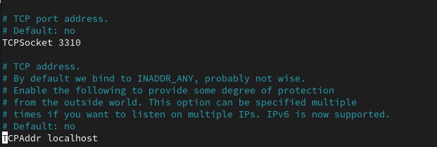
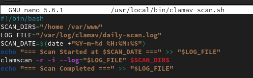
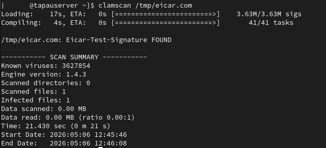
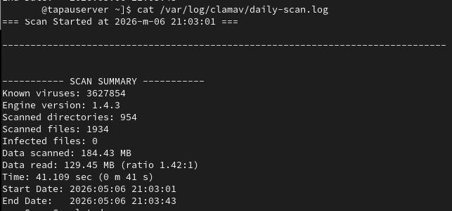
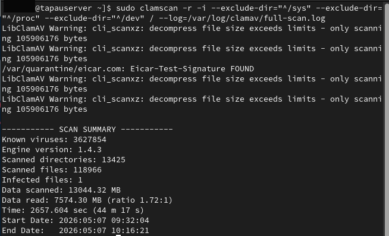

# 09 ClamAV antivirus

## Purpose

This runbook installs ClamAV on Rocky Linux 9.7 from EPEL, keeps its signatures current with `freshclam`, runs the `clamd` daemon on localhost, and schedules a daily scan of `/home` and `/var/www`. It is tested with the harmless EICAR test file, which ClamAV should flag, and with a quarantine directory.

## Environment

| Item | Value |
|---|---|
| Server | Rocky Linux 9.7, hostname `tapauserver.bungkus.org`, 192.168.200.4, interface `enp0s3` |
| Client | Ubuntu 24.04.4, hostname `tapauclient.bungkus.org`, 192.168.200.80 (DHCP) |
| Packages | `epel-release`, `clamav`, `clamav-update`, `clamd` (ClamAV 1.4.3, with `clamav-freshclam` and `clamav-lib` as dependencies) |
| Signatures | 3,627,854 known viruses at the time of the report |
| Domain | `bungkus.org` (fictional) |

## Steps

1. Enable EPEL. ClamAV is not in the Rocky 9 base repos, so the install fails without it.
   ```bash
   sudo dnf install -y epel-release
   sudo dnf update -y
   ```
2. Install the scanner, the signature updater and the daemon, then check the version.
   ```bash
   sudo dnf install -y clamav clamav-update clamd
   clamscan --version
   ```
3. Download the first signature set. Scanning does not work without a database in `/var/lib/clamav/`.
   ```bash
   sudo freshclam
   ```
4. Run the update daemon so signatures refresh on their own. The report states the default check interval is hourly.
   ```bash
   sudo systemctl enable --now clamav-freshclam
   sudo systemctl status clamav-freshclam
   ```
5. Edit the daemon config (see Configuration). Keeping the signatures loaded in `clamd` makes `clamdscan` much faster than `clamscan`, which reloads them on every run.
   ```bash
   sudo nano /etc/clamd.d/scan.conf
   ```
6. Start the daemon and enable it at boot.
   ```bash
   sudo systemctl enable --now clamd@scan
   sudo systemctl status clamd@scan
   ```
7. Run a manual scan with `clamscan`. `-r` recurses, `-i` prints infected files only, `--log` writes a log. The report's log directory is `/var/log/clamav/`.
   ```bash
   sudo clamscan -r -i --log=/var/log/clamav/manual-scan.log /home
   ```
8. Run a scan through the daemon. `--multiscan` uses several threads and `--fdpass` hands file descriptors to `clamd`.
   ```bash
   sudo clamdscan --multiscan --fdpass /var/www/html
   ```
9. Test detection with the EICAR file. It is an industry-standard 68-byte text file that is not a virus but that every antivirus engine flags on purpose. The report downloaded it from the EICAR site. Its content is not reproduced in this repo.
   ```bash
   curl -o /tmp/eicar.com https://secure.eicar.org/eicar.com
   clamscan /tmp/eicar.com
   ```
10. Quarantine the detected file with `--move` instead of deleting it, then list the folder.
    ```bash
    sudo mkdir -p /var/quarantine
    sudo clamscan --move=/var/quarantine /tmp/eicar.com
    ls -la /var/quarantine
    ```
11. Client interaction test. On the Ubuntu client, the report created an EICAR test file in the home directory with `echo`, copied it with `scp` to `/tmp/` on the server, and scanned it there. On the server:
    ```bash
    ls -la /tmp/eicar_test.txt
    clamscan /tmp/eicar_test.txt
    ```
    See Verification for what this scan returned.
12. Create the daily scan script and make it executable.
    ```bash
    sudo nano /usr/local/bin/clamav-scan.sh
    sudo chmod +x /usr/local/bin/clamav-scan.sh
    ```
13. Schedule it in root's crontab: minute 0, hour 2, every day.
    ```bash
    sudo crontab -e
    ```
    Add the line `0 2 * * * /usr/local/bin/clamav-scan.sh`.
14. Check the log the script writes.
    ```bash
    cat /var/log/clamav/daily-scan.log
    ```
15. Maintenance scan of the whole file system, skipping the pseudo file systems. It is heavy, so the report ran it as a separate job.
    ```bash
    sudo clamscan -r -i \
      --exclude-dir="^/sys" \
      --exclude-dir="^/proc" \
      --exclude-dir="^/dev" \
      / --log=/var/log/clamav/full-scan.log
    ```

## Configuration

- [clamd-scan.conf](../configs/09-clamav/clamd-scan.conf): partial. The six directives the report set in `/etc/clamd.d/scan.conf`: `LogFile /var/log/clamd.scan`, `LogTime yes`, `MaxThreads 20`, `MaxDirectoryRecursion 20`, `TCPSocket 3310` and `TCPAddr localhost`. The last two make `clamd` listen on port 3310 on localhost only; the stock comment says the default is to bind to every address.
- [clamav-scan.sh](../configs/09-clamav/clamav-scan.sh): the daily scan script. It scans `/home` and `/var/www`, appends to `/var/log/clamav/daily-scan.log`, and writes start and end marker lines. The date format in the screenshot is `%Y-m-%d`, which is a typo (see Verification).
- [crontab](../configs/09-clamav/crontab): the one cron line.

The report shows no change to `freshclam.conf`; it used the packaged defaults. So there is no `freshclam.conf` file in this repo.


*`TCPSocket 3310` and `TCPAddr localhost` uncommented in `scan.conf`, with the stock warning about binding to all addresses.*


*The daily scan script in `/usr/local/bin`.*


*The cron line in vim: `0 2 * * * /usr/local/bin/clamav-scan.sh`.*

## Verification

- `clamscan --version` printed ClamAV 1.4.3. `clamav-freshclam` and `clamd@scan` both showed `active (running)`. The later status check showed both with new start times (20:36), so both came back up on their own after a restart.
- `clamscan -r -i /home` scanned 1,930 files and found none (80 seconds). `clamdscan` on `/var/www/html` printed `OK` in 0.001 seconds, which suggests an empty or tiny directory; the report does not say.
- `clamscan /tmp/eicar.com` returned `Eicar-Test-Signature FOUND` with "Infected files: 1". After `--move`, the file sat in `/var/quarantine` (68 bytes).
- The daily script's log shows a run at 21:03 with "Infected files: 0" (1,934 files, 41 seconds). The header line reads `2026-m-06` because of the `%Y-m-%d` typo in the script; it should be `%Y-%m-%d`. The report does not show the cron run itself, only the log.
- The full-scan run found one infected file: the quarantined `/var/quarantine/eicar.com`. It scanned 118,966 files in about 44 minutes. The scan also printed `cli_scanxz` warnings that an archive's decompressed size exceeded the limit, so only the first 105,906,176 bytes were scanned.
- Client file test: `clamscan /tmp/eicar_test.txt` returned `OK` with "Infected files: 0". The report's caption claims it detected a threat, but the output does not. The report does not explain this, so treat the client-to-server detection test as not demonstrated.


*`clamscan /tmp/eicar.com` reports `Eicar-Test-Signature FOUND`.*


*The scheduled script's log with its summary. The date in the header shows the `%Y-m-%d` typo.*


*The full scan flags the EICAR file already sitting in `/var/quarantine`.*

## Troubleshooting

**`No match for argument: clamav` during install.**
- Cause: EPEL was not enabled, and the packages are not in the Rocky 9 base repos.
- Fix: `sudo dnf install -y epel-release`, then rerun the install.

**`scp` from the client fails with "Permission denied".**
- Cause (per the report): password login was off in the server's SSH config and the client had no SSH key for the server.
- Fix used: set `PasswordAuthentication yes` in `/etc/ssh/sshd_config` (the line was commented out), then `sudo systemctl restart sshd`. The transfer then worked.
- Trade-off: this is a temporary measure for the lab. Use an SSH key and turn password login off again.

**`systemctl status clamad@scan` says the unit could not be found.** A typo in the report; the unit is `clamd@scan`.

## Security notes

- `TCPAddr localhost` keeps `clamd` off the network. Without it, `clamd` binds to every address.
- `clamd` used about 1 GB of memory in the report (959 MB at first start, 1.1 GB later), mostly the signature set. Plan for that on a small VM.
- The quarantined file kept its original owner and was not locked down: the report's listing shows it as `-rw-r--r--` and owned by the admin user. Make `/var/quarantine` root-only and remove the execute and read bits for others on a real server.
