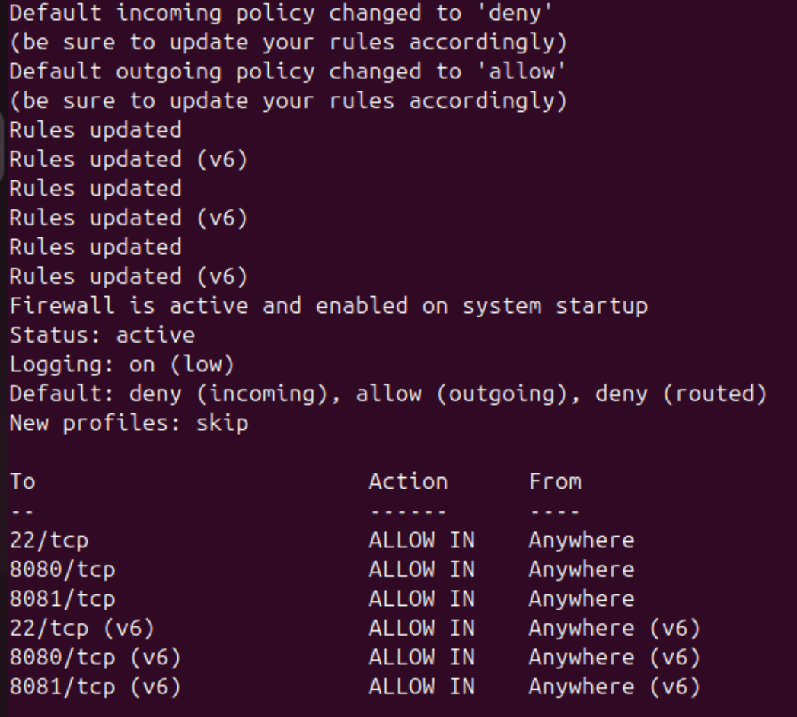
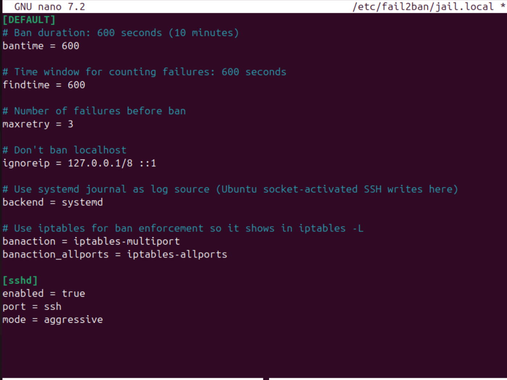
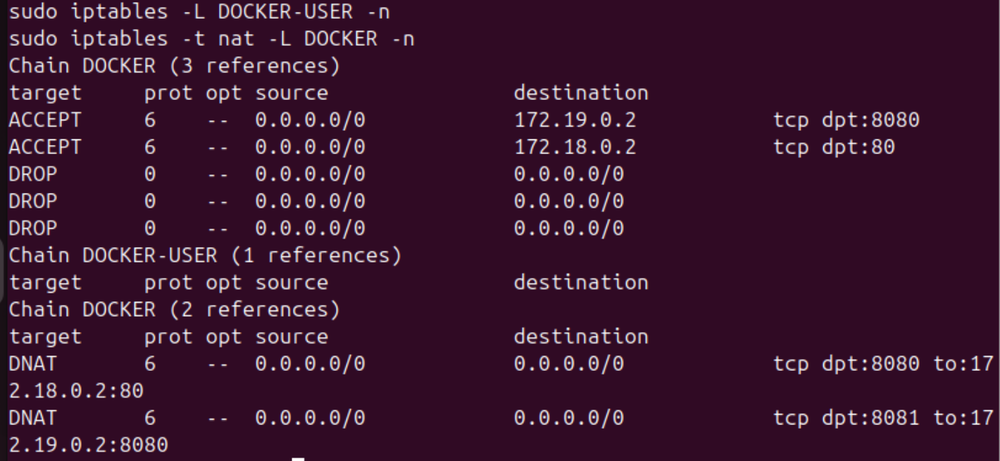
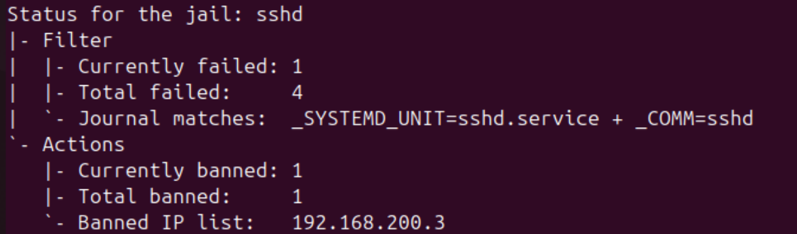
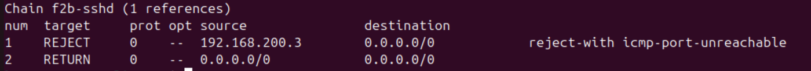
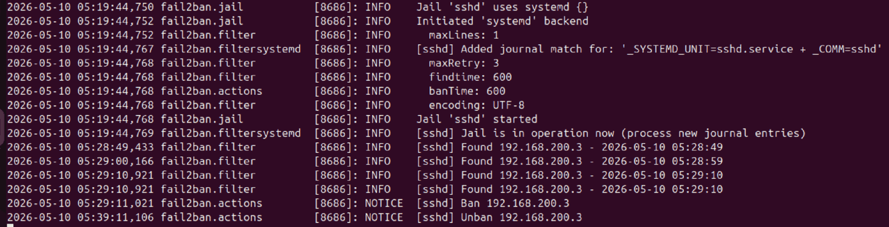

# 10 UFW and Fail2ban

## Purpose

This runbook locks down the Ubuntu client with two layers. UFW denies all incoming traffic except SSH and the two ports published by the Docker stack (see [06 Docker Compose](06-docker-compose.md)). Fail2ban watches the SSH log and bans any address that fails to log in three times within ten minutes. The demo at the end brute-forces SSH from the Rocky server and shows the ban and the automatic unban.

## Environment

| Item | Value |
|---|---|
| Protected host | Ubuntu client `tapauclient.bungkus.org`, 192.168.200.80 |
| Attacker in the demo | Rocky server `tapauserver.bungkus.org`, 192.168.200.3 |
| Packages | `ufw` (default on Ubuntu), `openssh-server`, `fail2ban` |
| Exposed ports | 22/tcp SSH, 8080/tcp nginx, 8081/tcp Adminer |
| Domain | `bungkus.org` (fictional) |

## Steps

### UFW

1. Deny everything inbound by default, allow outbound, then open only the three ports. The order matters: enable UFW last, so the SSH rule is already in place.
   ```bash
   sudo ufw default deny incoming
   sudo ufw default allow outgoing
   sudo ufw allow 22/tcp      # SSH
   sudo ufw allow 8080/tcp    # nginx
   sudo ufw allow 8081/tcp    # adminer
   sudo ufw enable
   sudo ufw status verbose
   ```
2. Check the rules both ways. `status numbered` shows UFW's own view, and the `iptables` listing shows that the INPUT chain policy is DROP, which is how "deny by default" is enforced in the kernel.
   ```bash
   sudo ufw status numbered
   sudo iptables -L INPUT -n --line-numbers
   ```
3. Look at the rules Docker adds itself. Docker publishes ports through its own `DOCKER` chains, ahead of UFW's chains.
   ```bash
   sudo iptables -L DOCKER -n
   sudo iptables -L DOCKER-USER -n
   sudo iptables -t nat -L DOCKER -n
   ```

### SSH server

4. Install and start OpenSSH, so there is something for Fail2ban to protect.
   ```bash
   sudo apt update
   sudo apt install -y openssh-server
   sudo systemctl start ssh
   sudo systemctl enable ssh
   sudo ss -tlnp | grep ssh
   ssh <user>@localhost
   ```

### Fail2ban

5. Install and start it.
   ```bash
   sudo apt install -y fail2ban
   sudo systemctl start fail2ban
   sudo systemctl enable fail2ban
   ```
6. Put the settings in `jail.local`. The packaged `jail.conf` is overwritten on updates, so changes go in `jail.local`, which overrides it.
   ```bash
   sudo nano /etc/fail2ban/jail.local
   ```
7. Restart and confirm the `sshd` jail is loaded.
   ```bash
   sudo systemctl restart fail2ban
   sudo fail2ban-client status
   sudo fail2ban-client status sshd
   ```

## Configuration

- [`configs/10-ufw-fail2ban/ufw-rules.sh`](../configs/10-ufw-fail2ban/ufw-rules.sh): the UFW commands.
- [`configs/10-ufw-fail2ban/jail.local`](../configs/10-ufw-fail2ban/jail.local): the complete Fail2ban file.

| Setting | Value | Meaning |
|---|---|---|
| `maxretry` | 3 | Failures before a ban |
| `findtime` | 600 | The failures must fall inside this many seconds |
| `bantime` | 600 | A ban lasts 10 minutes |
| `backend` | `systemd` | Reads failures from the journal, because Ubuntu's socket-activated SSH logs there |
| `banaction` | `iptables-multiport` | Bans show up as iptables rules |
| `mode` (sshd jail) | `aggressive` | Also counts failed key and protocol attempts |
| `ignoreip` | `127.0.0.1/8 ::1` | Localhost is never banned |



*UFW status: default deny incoming, with 22, 8080 and 8081 allowed.*



*The custom `jail.local`.*



*Docker's own chains: DNAT from 8080 to the nginx container and from 8081 to Adminer.*

## Verification

The demo, from the Rocky server:

1. Run `ssh <user>@192.168.200.80` and enter a wrong password three times.
2. On the Ubuntu client, watch the log with `sudo tail -f /var/log/fail2ban.log`.
3. Check the jail with `sudo fail2ban-client status sshd`.
4. Show the ban rule with `sudo iptables -L f2b-sshd -n --line-numbers`.
5. Show the failures with `sudo journalctl -u ssh -n 30 --no-pager | grep -i "failed\|invalid"`.
6. Wait ten minutes and watch the unban in the log, then log in again.



*The `sshd` jail shows 4 failures in total and 192.168.200.3 (the Rocky server) banned.*



*Fail2ban's `f2b-sshd` chain with a REJECT rule for the banned address.*



*The log: three "Found" lines, `Ban 192.168.200.3` at 05:29:11 and `Unban` at 05:39:11, exactly ten minutes later.*

## Troubleshooting

The report lists no separate problems for this section. The jail file itself records one fix: it sets `backend = systemd`, because on Ubuntu the SSH daemon is socket-activated and logs to the journal rather than to a log file that Fail2ban would otherwise read.

## Notes

- **UFW does not control the Docker ports.** The report's own `iptables` listing shows Docker adding its DNAT and ACCEPT rules in separate chains, which is why the section calls them rules "that bypass UFW". The 8080 and 8081 rules in UFW therefore document intent but are not what makes those ports reachable. Real restrictions on published Docker ports go in the `DOCKER-USER` chain, which is empty here.
- The jail counts 4 total failures in the screenshot, while the demo describes three wrong passwords. The log shows two entries at the same second, so the fourth is probably a repeated attempt in that burst.
- The last test in the report logs in to `192.168.200.30`, while the client address everywhere else is `192.168.200.80`. This is most likely a typo in the report.
- The attacker in this demo is another lab VM. The ban worked on the first address that failed, so a real attacker behind NAT would lock out everyone sharing that address.
- Ten-minute bans are short. For a real server, a longer `bantime` or the `recidive` jail would be a better choice.
